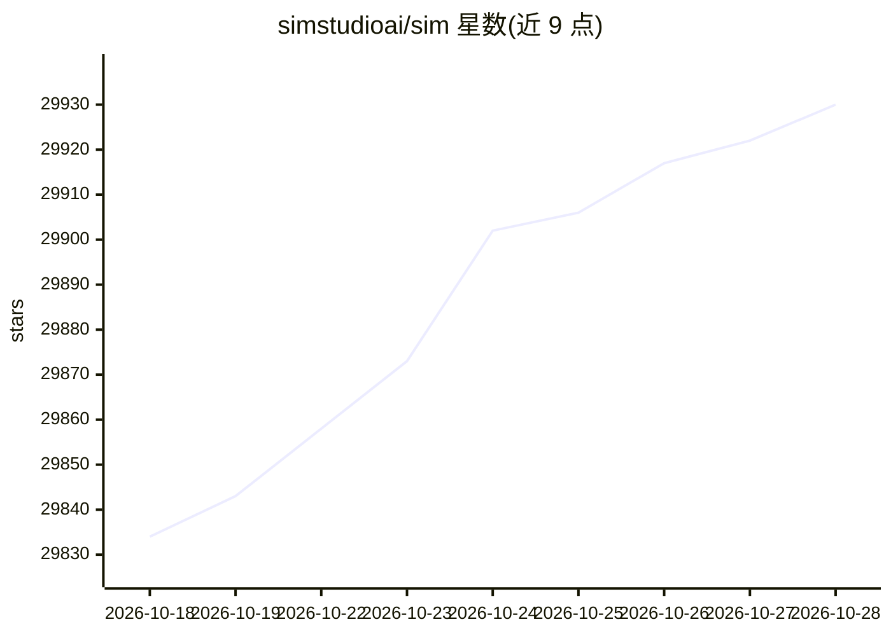

# simstudioai/sim

⭐ 29,930 · TypeScript · Apache-2.0 · 推送 2026-10-27 · [GitHub](https://github.com/simstudioai/sim) · [官网](https://www.sim.ai) · 组织维护

**给开发者的可视化 AI agent 与工作流构建平台**

Sim 提供一个协作工作区，用于构建、部署和管理 AI agent 与工作流：支持可视化/对话式/代码三种构建方式，内置数据库表格、文件存储、知识库，可接入 270+ 集成（5,400+ 动作、520+ 触发器），并提供运行监控、日志与调度。部署方式包括云端（sim.ai）、macOS 桌面应用（需 macOS 12+）和自托管（npx sim-setup 向导，需 Node.js 20+ 与 Docker）。自托管 Chat 服务由 Sim 管理并需 API key。

## 筛选速览

| 维度 | 判定 | 备注 |
|---|---|---|
| AI 角色 | `ai-native` | 本体是模型或模型工具 |
| 许可风险 | `permissive` | Apache-2.0 |
| 部署形态 | `self-host` | docker 或自建部署 |
| 模型依赖 | local-ok | 支持本地模型 |
| 硬件要求 | — | 无带数字的原话,不猜 |
| 安装摩擦 | `low` | 无编译、无系统依赖或容器化 |
| 成熟度 | — | 结构信号不足 |

## 动量与使用信号

- 维护:`active` — 距上次 push 0.6 天,年发版 100,53 位贡献者
- 涨星:近 1 天 **+2**(自 20261016 起算)
- 安装:npm 包 `sim-setup` 月下载 16,587
- 平台:MACOS · 协议:OLLAMA

## 能力要点

- 270+ 集成、5,400+ 动作、520+ 触发器
- 可视化/对话式/代码三种 agent 构建方式
- 内置表格数据库、文件存储与知识库（agent 共享工作区）
- 自托管安装向导 sim-setup 支持 Docker Compose、本地开发与 Kubernetes 模式

## 适用场景

- 搭建自动化工作流连接 Slack、Notion、Salesforce 等服务
- 团队协作构建并监控 AI agent
- 自托管部署并接入本地模型运行 agent

## 场景标签

`工作流自动化` `Agent 框架` · 领域:Agent 开发

## 证据(README 行号)

> L13:  A workspace to build, deploy and manage AI agents and workflows.
> L37: - Connect 270+ integrations (5,400+ actions, 520+ triggers) and every major LLM
> L61: **Requirements:** Node.js 20+ and Docker.

## 星数曲线

2026-10-18 29,834 → 2026-10-28 29,930（+96）

---
*卡片 v1 · prompt 1.4 · 生成 2026-10-18 · 置信度 high · 依据 README sha `32e7a0c12801` · [字段定义](../../DATASET.md)*
