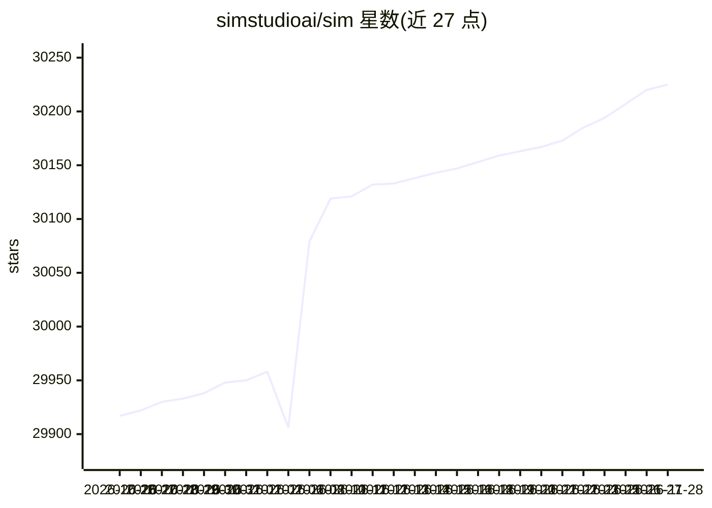

# simstudioai/sim

⭐ 30,225 · TypeScript · Apache-2.0 · 推送 2026-11-27 · [GitHub](https://github.com/simstudioai/sim) · [官网](https://www.sim.ai) · 组织维护

**面向构建者的 AI agent 与工作流搭建、部署、监控平台**

Sim 提供一个协作工作区，用于构建、部署和管理 AI agent 与工作流，支持可视化、对话式或代码方式构建 agent。平台内置数据库表、文件存储与知识库，接入 280+ 集成（5,800+ 动作、530+ 触发器）及主流 LLM，可监控运行、日志、调度与工作流活动。提供云托管（sim.ai）、自托管（npx sim-setup，需 Node.js 20+ 与 Docker）以及 macOS 桌面版三种形态；安全治理功能（SSO、SCIM、审计日志）归入企业版。

## 筛选速览

| 维度 | 判定 | 备注 |
|---|---|---|
| AI 角色 | `ai-ecosystem` | LLM/agent 周边工具 |
| 许可风险 | `permissive` | Apache-2.0 |
| 部署形态 | `self-host` | docker 或自建部署 |
| 模型依赖 | local-ok | 支持本地模型 |
| 硬件要求 | — | 无带数字的原话,不猜 |
| 安装摩擦 | `low` | 无编译、无系统依赖或容器化 |
| 成熟度 | — | 结构信号不足 |

## 动量与使用信号

- 维护:`active` — 距上次 push 0.6 天,年发版 100,53 位贡献者
- 涨星:近 1 天 **+2**(自 20261016 起算)
- 安装:npm 包 `sim-setup` 月下载 16,587
- 平台:MACOS · 协议:OLLAMA

## 能力要点

- 可视化、对话式或代码方式构建 agent 与工作流
- 280+ 集成（5,800+ 动作、530+ 触发器）及主流 LLM 接入
- 内置表、文件、知识库与运行监控
- 提供 MCP 服务器，可从 Claude/Codex 等客户端管理工作区与工作流

## 适用场景

- 低代码搭建并部署自动化 AI agent 工作流
- 自托管管理团队的 agent 运行、日志与调度
- 通过 MCP 客户端代为管理工作区与工作流

## 场景标签

`工作流自动化` `Agent 框架` · 领域:Agent 开发

## 证据(README 行号)

> L13:  A workspace to build, deploy and manage AI agents and workflows.
> L39: - Build agents visually, conversationally, or with code
> L113: Sim also supports local models via Ollama, vLLM, and LiteLLM. See the self-hosting docs for details.

## 星数曲线

2026-10-26 29,917 → 2026-11-28 30,225（+308）

---
*卡片 v1 · prompt 1.4 · 生成 2026-11-28 · 置信度 high · 依据 README sha `a8472019ee31` · [字段定义](../../DATASET.md)*
