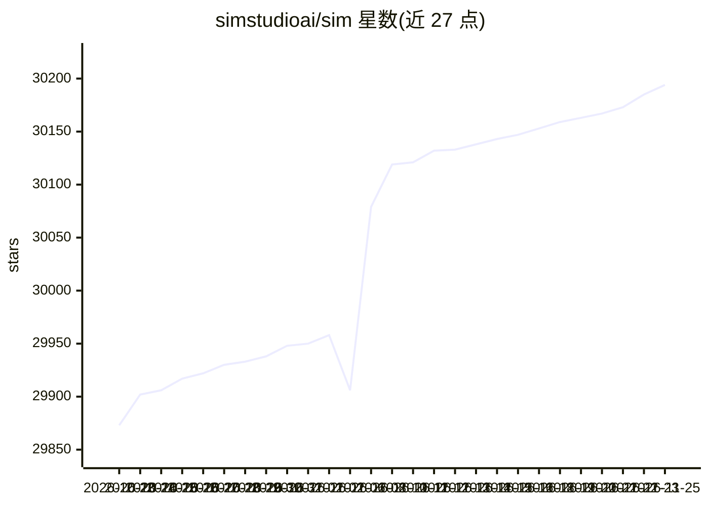

# simstudioai/sim

⭐ 30,194 · TypeScript · Apache-2.0 · 推送 2026-11-23 · [GitHub](https://github.com/simstudioai/sim) · [官网](https://www.sim.ai) · 组织维护

**团队协作构建、部署与监控 AI agent 和工作流的可视化平台**

Sim 是一个构建、部署和管理 AI agent 与工作流的协作工作区：提供可视化/对话/代码三种方式搭建 agent，内置 280+ 集成（5,800+ 动作、530+ 触发器），支持文件、数据库、知识库接入，并提供运行日志、调度与活动监控。企业计划提供 SSO（SAML/OIDC）、SCIM、审计日志与权限组等治理能力。可通过云托管（sim.ai）、macOS 桌面端或自托管（npx sim-setup + Docker Compose，需 Node.js 20+）使用，自托管还支持通过 Ollama/vLLM 接入本地模型，并提供 MCP server 供 Claude Code 等 MCP 客户端管理部署。

## 筛选速览

| 维度 | 判定 | 备注 |
|---|---|---|
| AI 角色 | `ai-ecosystem` | LLM/agent 周边工具 |
| 许可风险 | `permissive` | Apache-2.0 |
| 部署形态 | `self-host` | docker 或自建部署 |
| 模型依赖 | local-ok | 支持本地模型 |
| 硬件要求 | — | 无带数字的原话,不猜 |
| 安装摩擦 | `low` | 无编译、无系统依赖或容器化 |
| 成熟度 | — | 结构信号不足 |

## 动量与使用信号

- 维护:`active` — 距上次 push 0.6 天,年发版 100,53 位贡献者
- 涨星:近 1 天 **+2**(自 20261016 起算)
- 安装:npm 包 `sim-setup` 月下载 16,587
- 平台:MACOS · 协议:OLLAMA

## 能力要点

- 280+ 集成（5,800+ 动作、530+ 触发器）与主流 LLM 接入
- 可视化/对话/代码三种方式构建 agent
- 内置 Tables、Files、知识库统一工作区
- MCP server：Claude Code/Codex 等客户端可管理工作流

## 适用场景

- 低代码搭建自动化 AI agent 工作流
- 企业内自托管部署并做 SSO/审计治理
- 接入内部数据库与知识库让 agent 检索
- 通过 MCP 客户端管理已部署的工作流

## 场景标签

`工作流自动化` `RAG` · 领域:效率与自动化

## 证据(README 行号)

> L13:  A workspace to build, deploy and manage AI agents and workflows.
> L35: ## Capabilities
> L78: ## Self-hosting

## 星数曲线

2026-10-23 29,873 → 2026-11-25 30,194（+321）

---
*卡片 v1 · prompt 1.4 · 生成 2026-11-24 · 置信度 high · 依据 README sha `64f9ba1a014c` · [字段定义](../../DATASET.md)*
