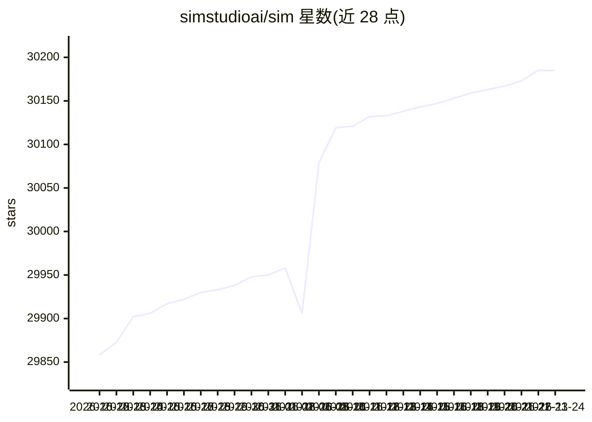

# simstudioai/sim

⭐ 30,185 · TypeScript · Apache-2.0 · 推送 2026-11-22 · [GitHub](https://github.com/simstudioai/sim) · [官网](https://www.sim.ai) · 组织维护

**可视化工作区：构建、部署与监控 AI agent 和工作流**

Sim 是构建、部署和管理 AI agent 与工作流的协作工作区。提供可视化/对话/代码三种构建方式，接入 280+ 集成（5,800+ 动作、530+ 触发器）与主流 LLM，内置表格、文件与知识库作为 agent 可查询的数据源，并监控运行日志与调度。支持云端（sim.ai）、macOS 桌面版与自托管（npx sim-setup 向导 + Docker Compose，需 Node.js 20+），提供 MCP 服务器供 Claude/Codex 等客户端管理部署，企业版含 SSO、SCIM 与审计日志。

## 筛选速览

| 维度 | 判定 | 备注 |
|---|---|---|
| AI 角色 | `ai-ecosystem` | LLM/agent 周边工具 |
| 许可风险 | `permissive` | Apache-2.0 |
| 部署形态 | `self-host` | docker 或自建部署 |
| 模型依赖 | local-ok | 支持本地模型 |
| 硬件要求 | — | 无带数字的原话,不猜 |
| 安装摩擦 | `low` | 无编译、无系统依赖或容器化 |
| 成熟度 | — | 结构信号不足 |

## 动量与使用信号

- 维护:`active` — 距上次 push 0.6 天,年发版 100,53 位贡献者
- 涨星:近 1 天 **+2**(自 20261016 起算)
- 安装:npm 包 `sim-setup` 月下载 16,587
- 平台:MACOS · 协议:OLLAMA

## 能力要点

- 280+ 集成、5,800+ 动作与 530+ 触发器，接入主流 LLM
- 可视化、对话或代码三种方式构建 agent
- 内置表格、文件与知识库作为 agent 数据源
- MCP 服务器：Claude/Codex 客户端可管理工作流与部署

## 适用场景

- 用可视化画布搭建业务自动化 agent 工作流
- 自托管部署并监控团队 agent 的运行与日志
- 让 agent 查询内部数据库、文件与知识库
- 通过 MCP 客户端远程管理 Sim 工作区

## 场景标签

`工作流自动化` `Agent 框架` · 领域:Agent 开发

## 证据(README 行号)

> L13:  A workspace to build, deploy and manage AI agents and workflows.
> L39: - Build agents visually, conversationally, or with code
> L70: Connect Claude, Claude Code, Codex, or any MCP client to Sim Cloud at `https://mcp.sim.ai/mcp`. Your agent can mana

## 星数曲线

2026-10-22 29,858 → 2026-11-24 30,185（+327）

---
*卡片 v1 · prompt 1.4 · 生成 2026-11-23 · 置信度 high · 依据 README sha `11fa6fe06a63` · [字段定义](../../DATASET.md)*
