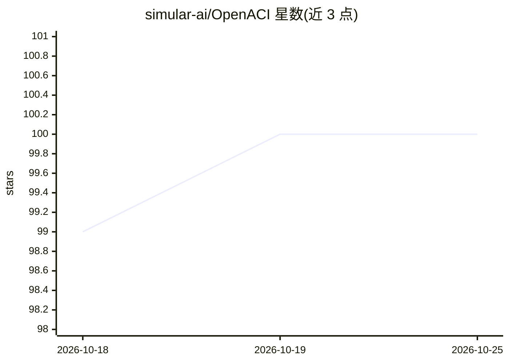

# simular-ai/OpenACI

⭐ 100 · Python · Apache-2.0 · 推送 2026-08-17 · [GitHub](https://github.com/simular-ai/OpenACI) · 组织维护

**让 agent 依自然语言指令自主操控计算机的开源接口**

OpenACI 是实验性的 Agent Computer Interface：接收自然语言指令后让 agent 自主操作计算机执行任务，用户可通过 Ctrl+C 随时中断。运行依赖 OpenAI API key，通过 CLI 启动（python openaci/cli_app.py）。macOS 需额外安装 Xcode 开发者工具包与 pyobjc-framework-ApplicationServices。README 明确声明为实验性代码，并列出未授权访问、数据损坏、系统不稳定与法律合规等风险，建议仅在受控环境测试。Apache 2.0 许可。

## 筛选速览

| 维度 | 判定 | 备注 |
|---|---|---|
| AI 角色 | `ai-ecosystem` | LLM/agent 周边工具 |
| 许可风险 | `permissive` | Apache-2.0 |
| 部署形态 | `library` | 以包/库形式分发 |
| 模型依赖 | — | README 未给出锁定关系 |
| 硬件要求 | — | 无带数字的原话,不猜 |
| 安装摩擦 | `low` | 无编译、无系统依赖或容器化 |
| 成熟度 | `idea` | |

## 能力要点

- 自然语言指令驱动 agent 自主操控计算机
- CLI 运行，终端键盘中断可随时停止 agent
- macOS 支持（需 Xcode 工具包与 pyobjc 依赖）

## 适用场景

- 用自然语言让 agent 代为执行桌面任务
- 在受控环境中实验 agent 操控计算机的能力

## 场景标签

`GUI 自动化` `AI 助手` · 领域:效率与自动化

## 证据(README 行号)

> L3: tl;dr: OpenACI is an interfact that allows computers to control itself and perform tasks autonomously according to n
> L39: python openaci/cli_app.py

## 星数曲线

2026-10-18 99 → 2026-10-25 100（+1）

---
*卡片 v1 · prompt 1.4 · 生成 2026-10-23 · 置信度 mid · 依据 README sha `09e626b86e67` · [字段定义](../../DATASET.md)*
