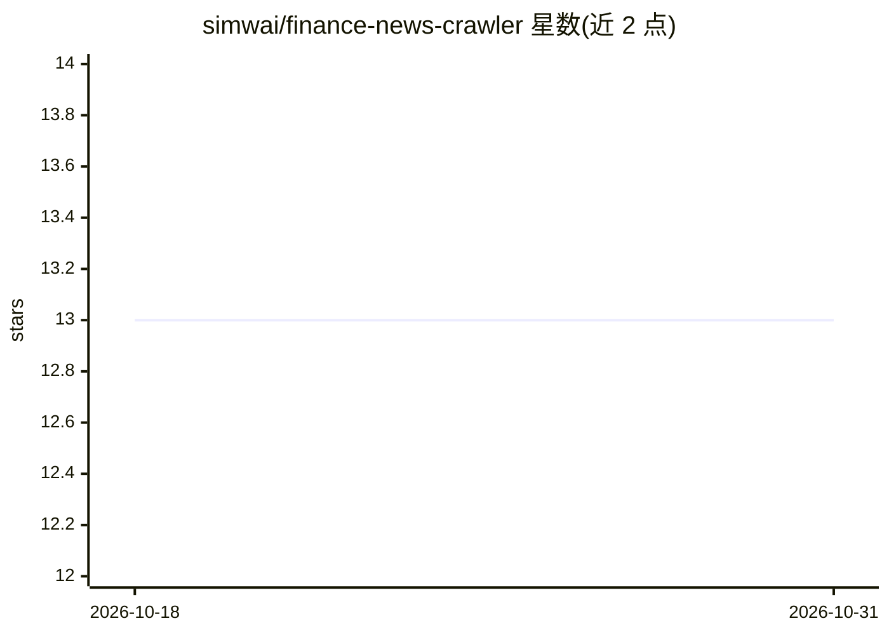

# simwai/finance-news-crawler

⭐ 13 · JavaScript · 推送 2026-08-31 · [GitHub](https://github.com/simwai/finance-news-crawler) · 个人维护

**抓取金融新闻并生成加密/股票/外汇情绪报告的工具**

基于 Node.js 的金融新闻爬虫：通过 News API 抓取最新财经新闻文章，调用 OpenAI GPT API 或本地 VADER 词典规则方法做情感分析，最终在控制台输出覆盖加密货币、股票与外汇市场的情绪报告。面向需要跟踪市场新闻情绪的用户，需自备 News API key 与 OpenAI API key（选 VADER 则无需后者）。通过 git clone 源码加 npm install 安装，可自定义抓取参数与报告格式。

## 筛选速览

| 维度 | 判定 | 备注 |
|---|---|---|
| AI 角色 | `ai-native` | 本体是模型或模型工具 |
| 许可风险 | `permissive` | — |
| 部署形态 | `library` | 以包/库形式分发 |
| 模型依赖 | — | README 未给出锁定关系 |
| 硬件要求 | — | 无带数字的原话,不猜 |
| 安装摩擦 | `low` | 无编译、无系统依赖或容器化 |
| 成熟度 | — | 结构信号不足 |

## 能力要点

- 经 News API 抓取财经新闻文章
- 情感分析可选 OpenAI GPT 或 VADER（词典规则）两种算法
- 输出覆盖 crypto、股票、外汇市场的情绪报告

## 适用场景

- 我想跟踪加密货币、股票和外汇的新闻情绪
- 我想用本地 VADER 或 GPT 两种方式做情感分析并对比
- 我想自定义新闻来源与报告输出格式

## 场景标签

`网页抓取` `金融量化` · 领域:效率与自动化

## 证据(README 行号)

> L8: The Finance News Crawler is a powerful tool that allows you to crawl finance news articles, perform sentiment analys
> L15: - Performs sentiment analysis using OpenAI GPT API

## 星数曲线

2026-10-18 13 → 2026-10-31 13（+0）

---
*卡片 v1 · prompt 1.4 · 生成 2026-10-31 · 置信度 high · 依据 README sha `7095e3c27ae7` · [字段定义](../../DATASET.md)*
