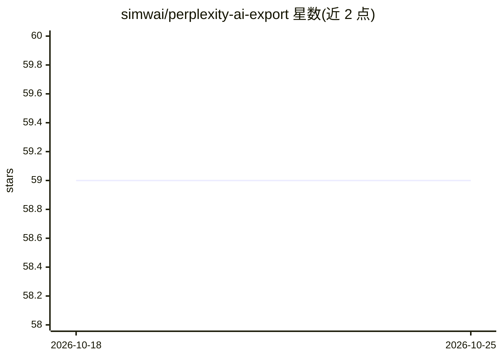

# simwai/perplexity-ai-export

⭐ 60 · TypeScript · NOASSERTION · 推送 2026-10-17 · [GitHub](https://github.com/simwai/perplexity-ai-export) · 个人维护

**导出 Perplexity 对话历史并构建本地可检索的 RAG 知识库**

基于 Playwright 的 Perplexity.ai 对话历史抓取工具：并行提取多个会话线程（含 SHA-256 内容哈希跳过未变更线程、断点续传），导出为组织化的 Markdown 文件夹结构。搜索层提供 ripgrep 精确匹配、本地向量语义检索与 RAG 问答（HyDE 增强、ONNX 交叉编码器重排序、MapReduce 事实抽取、带来源引用的综合回答），可通过本地 Ollama 或任意 OpenAI 兼容 API 驱动。在 Windows + PowerShell 7.6 + WSL 环境开发测试，headless 模式因 Cloudflare 挑战不可用。

## 筛选速览

| 维度 | 判定 | 备注 |
|---|---|---|
| AI 角色 | `ai-native` | 本体是模型或模型工具 |
| 许可风险 | `none` | NOASSERTION |
| 部署形态 | `library` | 以包/库形式分发 |
| 模型依赖 | local-ok | 支持本地模型 |
| 硬件要求 | — | 无带数字的原话,不猜 |
| 安装摩擦 | `low` | 无编译、无系统依赖或容器化 |
| 成熟度 | — | 结构信号不足 |

## 能力要点

- Playwright 并行抓取 Perplexity 会话并导出 Markdown
- RAG 管线：HyDE + ONNX 交叉编码器重排序 + MapReduce 事实抽取 + 引用来源的综合
- SHA-256 内容哈希跳过未变更线程，减少重复抓取
- AI 提供方可选：本地 Ollama 或 OpenAI 兼容 API

## 适用场景

- 备份并整理我在 Perplexity 的全部对话记录
- 用自然语言向自己的历史提问并得到带来源引用的回答
- 对导出的历史做语义/精确混合搜索

## 场景标签

`网页抓取` `RAG` · 领域:效率与自动化

## 证据(README 行号)

> L13: This tool is designed to externalize your Perplexity.ai conversation history into organized, semantically searchabl
> L19: - **Advanced RAG (Retrieval-Augmented Generation)**: Engage in a cognitive dialogue with your history. The system e
> L119:  - **RAG**: Direct inquiry, such as "What did I learn about emergent intelligence?"

## 星数曲线

2026-10-18 59 → 2026-10-25 59（+0）

---
*卡片 v1 · prompt 1.4 · 生成 2026-10-24 · 置信度 mid · 依据 README sha `714f77ebc688` · [字段定义](../../DATASET.md)*
