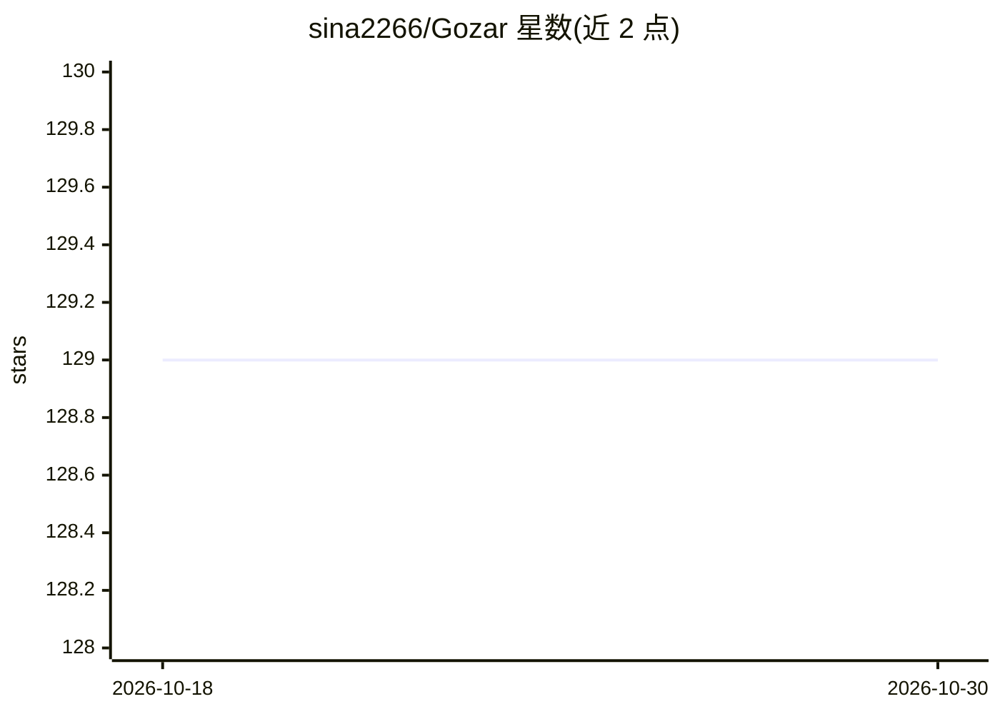

# sina2266/Gozar

⭐ 129 · Python · NOASSERTION · 推送 2026-08-05 · [GitHub](https://github.com/sina2266/Gozar) · 个人维护

**自托管 OpenAI 兼容 LLM 网关：统一入口路由多上游并带回退**

面向本地项目、私有团队与开发者工作流的自托管 LLM 网关。应用通过一个稳定的 /v1 端点与 Gozar API key 访问，网关负责将请求路由到运营者管理的上游账户（OpenAI、OpenRouter 等 API key 供应商，以及 Codex、Anthropic 等订阅账户），支持双通道（LLM/Embeddings）回退链、按 key 的用量限额、请求追踪与分析、凭据加密存储。提供 Web 控制台管理账户、密钥、链路与模型目录。以 Docker Compose 部署为主，Python 3.12 + FastAPI + React 实现。许可为 PolyForm Noncommercial 1.0.0，限定非商业自托管用途。

## 筛选速览

| 维度 | 判定 | 备注 |
|---|---|---|
| AI 角色 | `ai-ecosystem` | LLM/agent 周边工具 |
| 许可风险 | `none` | NOASSERTION |
| 部署形态 | `self-host` | docker 或自建部署 |
| 模型依赖 | locked-api |  |
| 硬件要求 | — | 无带数字的原话,不猜 |
| 安装摩擦 | `low` | 无编译、无系统依赖或容器化 |
| 成熟度 | — | 结构信号不足 |

## 能力要点

- OpenAI 兼容的 /v1/chat/completions、/v1/embeddings、流式 SSE 与 /v1/models 端点
- LLM 与 Embeddings 双通道回退链，每节点可独立选择账户、模型与回退策略
- 每应用/工作流签发独立 Gozar API key，运营者集中管理上游凭据
- Codex 设备码登录、凭据加密存储、用量限额与请求追踪分析

## 适用场景

- 为多个本地项目或 agent 提供统一的 LLM 访问入口，避免向每个项目暴露上游密钥
- 为生产流量配置跨供应商的回退链与链路健康检查
- 在 RAG 应用中通过同一网关与 API key 使用 Chat 与 Embeddings 端点

## 场景标签

`模型网关` · 领域:Agent 开发

## 证据(README 行号)

> L3: **Gozar is a self-hosted, OpenAI-compatible LLM gateway for local projects, private
> L5: Gozar API key while the gateway routes requests through operator-managed upstream
> L62: - **Data path: `/v1`** - the OpenAI-compatible endpoint used by your applications.

## 星数曲线

2026-10-18 129 → 2026-10-30 129（+0）

---
*卡片 v1 · prompt 1.4 · 生成 2026-10-22 · 置信度 mid · 依据 README sha `5a484209e22b` · [字段定义](../../DATASET.md)*
