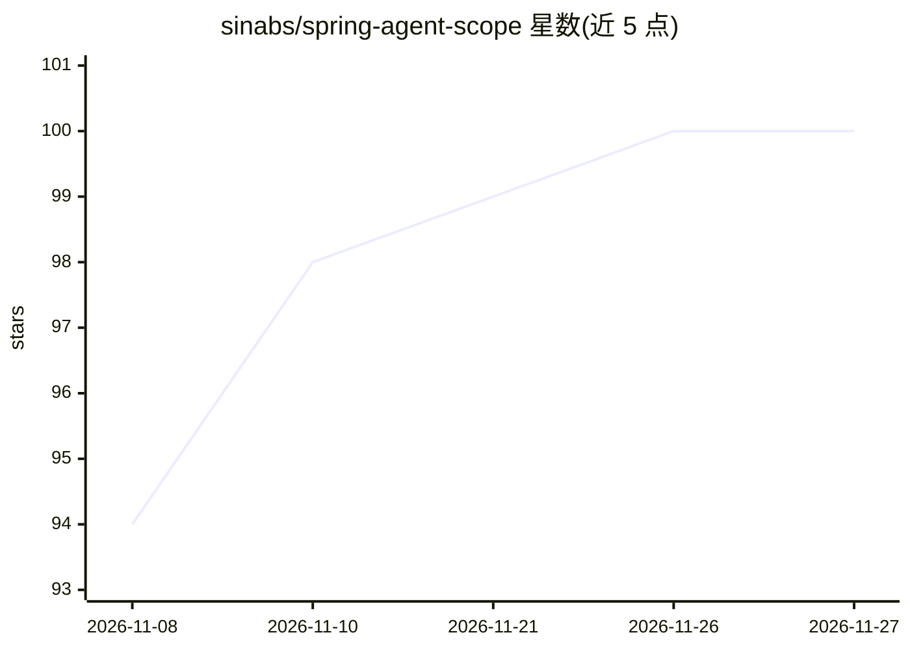

# sinabs/spring-agent-scope

⭐ 100 · Java · Apache-2.0 · 推送 2026-11-24 · [GitHub](https://github.com/sinabs/spring-agent-scope) · 组织维护 · 中文 README

**给 Java 开发者的 Spring Boot agent 服务脚手架：多轮对话、会话隔离**

基于 Spring Boot 4 与 AgentScope Java 2.0、JDK 25 的单体 agent 服务工程（Yoke）：提供 /api/chat 多轮对话端点与 /api/chat/stream 的 AG-UI 协议 SSE 流式端点；每个请求构建临时 HarnessAgent 并在结束后关闭，会话历史按 (userId, sessionId) 隔离存于 Redis，支持压缩与重启存活。内置天气、计算器、检索等工具与两个子 agent，模型通过官方 starter 接入 OpenAI 兼容 API、Anthropic、Gemini 与 Ollama。暂无身份认证，同会话并发请求未串行化，也未经负载测试。运行需 JDK 25 与 Docker（本地 Redis）。

## 筛选速览

| 维度 | 判定 | 备注 |
|---|---|---|
| AI 角色 | `ai-ecosystem` | LLM/agent 周边工具 |
| 许可风险 | `permissive` | Apache-2.0 |
| 部署形态 | `self-host` | docker 或自建部署 |
| 模型依赖 | local-ok | 支持本地模型 |
| 硬件要求 | — | 无带数字的原话,不猜 |
| 安装摩擦 | `low` | 无编译、无系统依赖或容器化 |
| 成熟度 | — | 结构信号不足 |

## 能力要点

- 每请求临时 agent + Redis 按会话隔离存储历史，重启存活、副本共享
- POST /api/chat 与 AG-UI 协议的 SSE 流式端点，流式输出推理过程
- 模型接入 OpenAI 兼容 API（DashScope/DeepSeek）、Anthropic、Gemini、Ollama，切换仅需改依赖与配置
- 内置工具（天气/计算器/检索/子 agent）与 HTTP MCP 服务器接入，无文件/shell/web 工具

## 适用场景

- 以 Spring Boot 工程为起点搭建可对外的多轮对话 agent 服务
- 学习 AgentScope Java V2 在真实工程中的分层与会话管理决策
- 通过 AG-UI 协议接入前端做流式推理展示

## 场景标签

`Agent 框架` · 领域:Agent 开发

## 证据(README 行号)

> L14: **Yoke** · AgentHarness: a monolithic agent service built on Spring Boot and AgentScope Java (V2).
> L18: Yoke is an open-source project of 友客AI (YouKe AI). We read the AgentScope Java V2 and Spring source code together a
> L31: - Models are plugged in through the official AgentScope starters: OpenAI-compatible APIs (works with DashScope, Dee

## 星数曲线

2026-11-08 94 → 2026-11-27 100（+6）

---
*卡片 v1 · prompt 1.4 · 生成 2026-11-17 · 置信度 high · 依据 README sha `1192a873aac1` · [字段定义](../../DATASET.md)*
