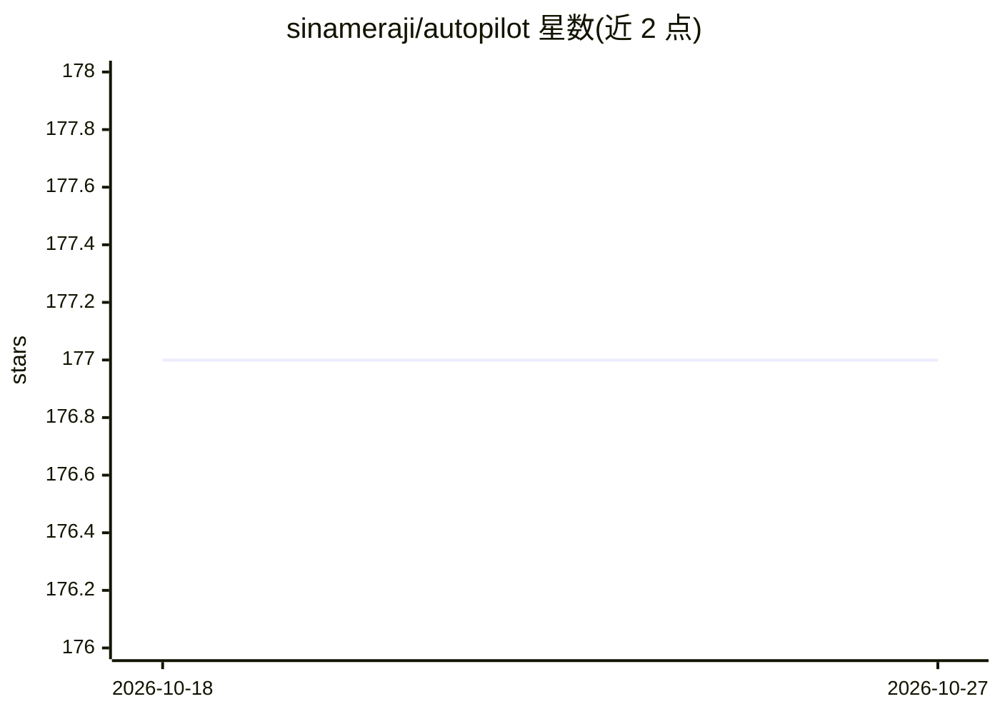

# sinameraji/autopilot

⭐ 177 · TypeScript · MIT · 推送 2026-10-26 · [GitHub](https://github.com/sinameraji/autopilot) · [官网](https://directionallylocal.com/autopilot) · 个人维护

**自带密钥的终端编码 agent 与 SDK，支持 25+ 提供商**

终端编码 agent，模型调用全部发送到用户自选的提供商并使用用户自己的 key（bring-your-own-key，不经代理）。首Run 时选择提供商并挑模型即可使用；默认推荐 OpenRouter（400+ 模型、按轮计费、粘性路由），另支持 OpenAI、DeepSeek、Anthropic、Amazon Bedrock、Azure、本地 Ollama/LM Studio 及任意 OpenAI 兼容端点。功能含 Plan/Edit/Auto 三种权限模式、沙箱子代理、headless SDK（createAgentSession 与 JSONL-over-stdio）、LSP/MCP、SQLite 跨会话记忆与 Web/GitHub/无头浏览器工具。需 Node.js ≥ 20，提供 npm 全局安装与 Homebrew 安装。

## 筛选速览

| 维度 | 判定 | 备注 |
|---|---|---|
| AI 角色 | `ai-native` | 本体是模型或模型工具 |
| 许可风险 | `permissive` | MIT |
| 部署形态 | `desktop` | 安装包/桌面程序 |
| 模型依赖 | local-ok | 支持本地模型 |
| 硬件要求 | — | 无带数字的原话,不猜 |
| 安装摩擦 | `low` | 无编译、无系统依赖或容器化 |
| 成熟度 | — | 结构信号不足 |

## 能力要点

- bring-your-own-key 接入 25+ 提供商（含本地 Ollama / LM Studio / 任意 OpenAI 兼容端点）
- Plan/Edit/Auto 三级权限模式与子代理委派
- headless SDK：createAgentSession API 与 JSONL-over-stdio RPC
- LSP + MCP 集成与 SQLite 跨会话记忆

## 适用场景

- 在终端用自己 API key 驱动多模型完成编码任务
- 无人值守长时间任务：分离作业、检查点恢复、预算控制
- 以 SDK 形式在其之上构建 agent 应用

## 场景标签

`编码 Agent` `Agent 框架` · 领域:Agent 开发

## 证据(README 行号)

> L13:  A terminal coding agent that runs on your own provider key.
> L20: autopilot sends every model call to **the provider you choose** using **your own key** — bring-your-own-key, nothin

## 星数曲线

2026-10-18 177 → 2026-10-27 177（+0）

---
*卡片 v1 · prompt 1.4 · 生成 2026-10-22 · 置信度 high · 依据 README sha `29563e79fe83` · [字段定义](../../DATASET.md)*
