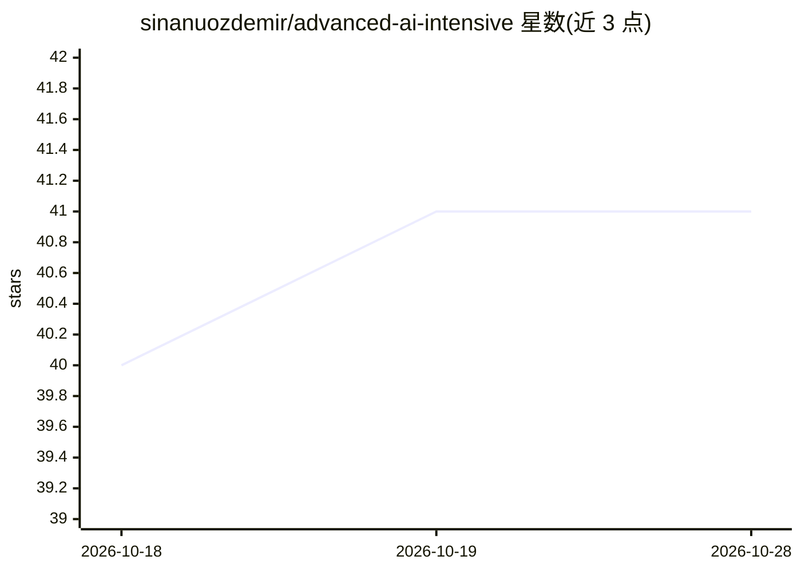

# sinanuozdemir/advanced-ai-intensive

⭐ 41 · Jupyter Notebook · 推送 2026-07-29 · [GitHub](https://github.com/sinanuozdemir/advanced-ai-intensive) · [官网](https://www.oreilly.com/live-events/ai-engineering-intensive/0642572375317/0642572375300/) · 个人维护

**O'Reilly 三周进阶 Agent/AI 工程课程配套代码仓库**

为两门 O'Reilly 直播课程（Advanced Agentic Systems Intensive 与 AI Engineering Intensive）提供代码：全部 notebook 平铺在 notebooks/ 目录，两门课共用文件但自第二周起顺序分叉。内容覆盖 agentic RAG、多跳检索、MCP 工具编排、多 Agent 拓扑、长期记忆、检查点恢复、后训练（CORD-V2 视觉 SFT）与 LLM-as-judge 评测，生产代码位于 src/，并含 Flask/Celery 与 FastAPI/Electron 两个 capstone 应用。使用需 Python 3.11 虚拟环境、OPENROUTER_API_KEY，先运行 build_corpus.ipynb 构建语料与索引。要求学员已具备中高级 Python、RAG 与至少一种 Agent 框架基础，不覆盖入门内容。

## 筛选速览

| 维度 | 判定 | 备注 |
|---|---|---|
| AI 角色 | `ai-knowledge` | 知识聚合/清单类 |
| 许可风险 | `none` | — |
| 部署形态 | `library` | 以包/库形式分发 |
| 模型依赖 | locked-api |  |
| 硬件要求 | — | 无带数字的原话,不猜 |
| 安装摩擦 | `low` | 无编译、无系统依赖或容器化 |
| 成熟度 | — | 结构信号不足 |

## 能力要点

- 两门课程共用 notebook，按周计划表组织（RAG/MCP/多Agent/记忆/评测）
- capstone 应用：Flask/Celery 多 Agent SDR 与 FastAPI+Electron 的 Forge 编码 agent
- 需 OPENROUTER_API_KEY，一个 key 访问课程用到的多家模型
- 构建语料 notebook 生成 Chroma 索引、BM25 索引与 gold set，可幂等重跑

## 适用场景

- 跟随 O'Reilly 课程系统学习高级 Agent 与 AI 工程模式
- 参考 LLM-as-judge 评测与记忆/规划 bake-off notebook 做对比实验
- 复用 src/ 中的多 Agent、MCP、记忆中间件代码模式

## 场景标签

`教程课程` · 领域:学习与行业

## 证据(README 行号)

> L5: This repository contains code for the O'Reilly live courses: Advanced Agentic Systems Intensive & AI Engineering Int
> L7: These three-week intensives go beyond introductory RAG and agents to build advanced AI workflows, models, and retrie
> L9: All notebooks live in a **single flat directory** (`notebooks/`) with unnumbered filenames. **Week order is defined 

## 星数曲线

2026-10-18 40 → 2026-10-28 41（+1）

---
*卡片 v1 · prompt 1.4 · 生成 2026-10-25 · 置信度 high · 依据 README sha `32281fa91d0f` · [字段定义](../../DATASET.md)*
