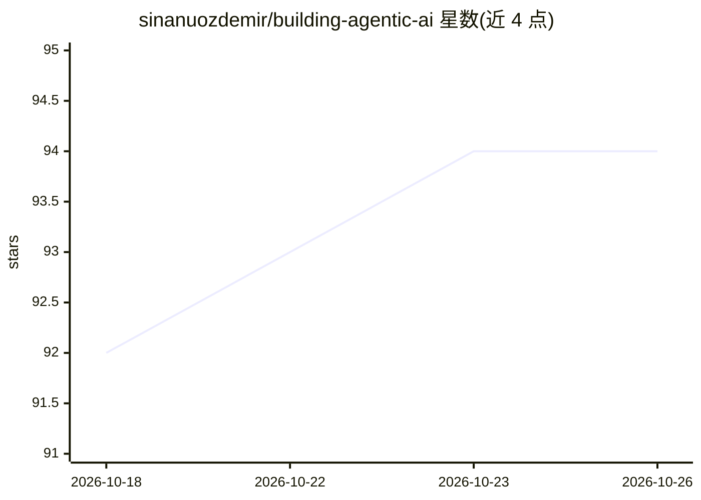

# sinanuozdemir/building-agentic-ai

⭐ 94 · Jupyter Notebook · 推送 2026-02-05 · [GitHub](https://github.com/sinanuozdemir/building-agentic-ai) · [官网](https://a.co/d/eaTeURV) · 个人维护

**《Applied AI》图书配套代码仓库：LLM/Agent/RAG 实战案例集**

Sinan Ozdemir 所著《Applied AI》（O'Reilly/Pearson）的官方代码仓库，按三幕组织：基础（LLM、嵌入、检索、工作流）、Agent（设计、部署、评测）、优化（微调、量化、蒸馏）。提供 8 个以上案例：Text-to-SQL RAG 工作流、LLM 评测与实验、提示位置偏差分析、ReAct Agent、AI 评分量规、MCP 多智能体 SDR、提示工程 Agent 等。需自备 OpenAI/OpenRouter 等 API key，多数案例以 Jupyter notebook 与 Python 脚本形式交付。

## 筛选速览

| 维度 | 判定 | 备注 |
|---|---|---|
| AI 角色 | `ai-knowledge` | 知识聚合/清单类 |
| 许可风险 | `none` | — |
| 部署形态 | `self-host` | docker 或自建部署 |
| 模型依赖 | locked-api |  |
| 硬件要求 | — | 无带数字的原话,不猜 |
| 安装摩擦 | `low` | 无编译、无系统依赖或容器化 |
| 成熟度 | — | 结构信号不足 |

## 能力要点

- LangGraph 驱动的 Text-to-SQL RAG 工作流（ChromaDB 向量存储）
- ReAct Agent 实现与长期记忆实验、成本对比
- MCP 多智能体 SDR 系统（Flask + Celery + 自建 MCP 服务器）
- Pydantic 结构化输出的 AI 评分量规与偏差缓解

## 适用场景

- 跟着图书章节动手复现 LLM/Agent/RAG 案例
- 学习如何系统评测与实验提示、模型与嵌入模型
- 参考多智能体 + MCP 的工程架构实现

## 场景标签

`教程课程` `RAG` `多智能体` `微调` · 领域:Agent 开发

## 证据(README 行号)

> L7: This repository contains code examples, experiments, and implementations for the **Applied AI** book by Sinan Ozdemi
> L13: The book is organized in three acts:
> L85: ## Case Studies

## 星数曲线

2026-10-18 92 → 2026-10-26 94（+2）

---
*卡片 v1 · prompt 1.4 · 生成 2026-10-23 · 置信度 mid · 依据 README sha `2ded8a1ba66e` · [字段定义](../../DATASET.md)*
