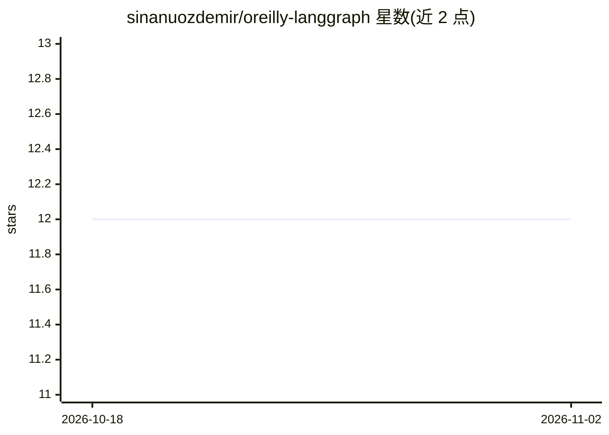

# sinanuozdemir/oreilly-langgraph

⭐ 12 · Jupyter Notebook · 推送 2026-05-22 · [GitHub](https://github.com/sinanuozdemir/oreilly-langgraph) · [官网](https://www.oreilly.com/live-events/building-ai-agents-and-workflows-with-langgraph/0642572283223) · 个人维护

**LangGraph 构建 AI Agent 与工作流的 O'Reilly 课程配套代码**

Sinan Ozdemir 的 O'Reilly 在线课程《Building AI Agents and Workflows with LangGraph》的代码仓库，含 9 组 Jupyter Notebook：从基础图概念、工具与 ReAct Agent、MCP 集成、RAG 工作流、上下文工程中间件、LLM-as-judge 评测，到深度研究 Agent 终期项目与并行图。所有 Notebook 通过 OpenRouter 作为 LLM 网关（可换模型字符串切换模型），网络搜索用 SerpAPI，RAG 嵌入用 HuggingFace 本地模型无需 API key。需 Python 3.11 虚拟环境并配置 .env 密钥。

## 筛选速览

| 维度 | 判定 | 备注 |
|---|---|---|
| AI 角色 | `ai-knowledge` | 知识聚合/清单类 |
| 许可风险 | `none` | — |
| 部署形态 | `library` | 以包/库形式分发 |
| 模型依赖 | locked-api |  |
| 硬件要求 | — | 无带数字的原话,不猜 |
| 安装摩擦 | `low` | 无编译、无系统依赖或容器化 |
| 成熟度 | — | 结构信号不足 |

## 能力要点

- 9 组 Notebook 覆盖图基础到深度研究 Agent 的完整路径
- 通过 OpenRouter 统一接入多个 LLM，改模型字符串即可切换
- 含可运行的 MCP 服务器与自定义中间件（压缩/护栏/人机协同）
- LLM-as-judge 评测与九模型评分器基准对比

## 适用场景

- 跟随课程系统学习 LangGraph 的 Agent 与工作流开发
- 参考 RAG 工作流、中间件与评测 Notebook 的实现模式
- 复用 MCP 集成与多 Agent supervisor 模式示例代码

## 场景标签

`教程课程` · 领域:学习与行业

## 证据(README 行号)

> L5: This repository contains code for my live course: O'Reilly Live Online Training - Building AI Agents and Workflows w
> L11: This course teaches you how to build production-ready AI agents and workflows using LangGraph. You'll progress from

## 星数曲线

2026-10-18 12 → 2026-11-02 12（+0）

---
*卡片 v1 · prompt 1.4 · 生成 2026-11-01 · 置信度 high · 依据 README sha `6107569af125` · [字段定义](../../DATASET.md)*
