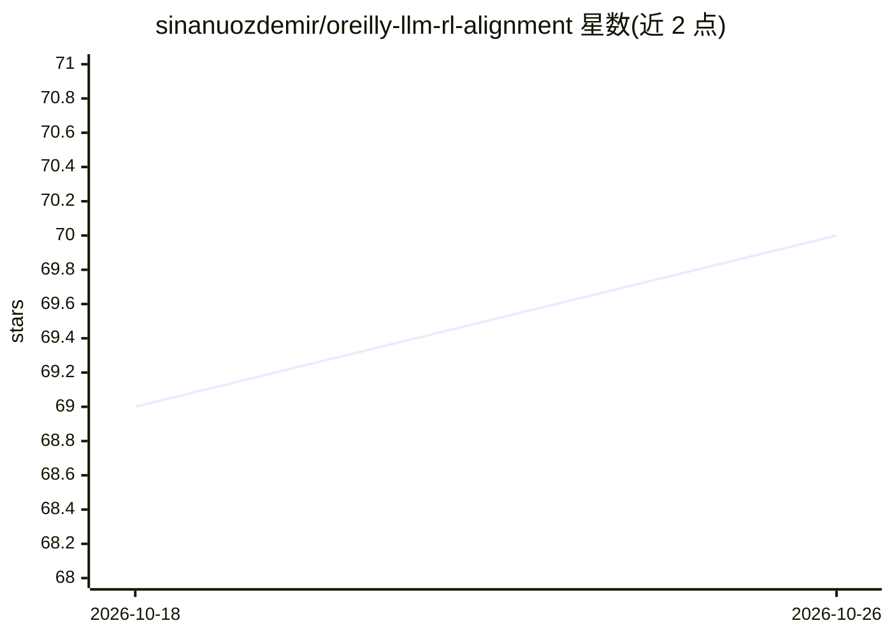

# sinanuozdemir/oreilly-llm-rl-alignment

⭐ 70 · Jupyter Notebook · 推送 2026-03-09 · [GitHub](https://github.com/sinanuozdemir/oreilly-llm-rl-alignment) · [官网](https://www.oreilly.com/live-events/reinforcement-learning-with-large-language-models/0636920095685) · 个人维护

**O'Reilly/Pearson LLM 对齐与强化学习课程的配套笔记本集**

包含两门课程的 Jupyter 笔记本：'Aligning Large Language Models' 与 'Reinforcement Learning with Large Language Models'，作者 Sinan Ozdemir，由 Pearson/O'Reilly 发布。内容覆盖 Constitutional AI、RLHF、RLAIF、奖励建模、PPO、DPO、RLOO、GRPO、提示注入与红队基准等主题，涉及 FLAN-T5、T5、Llama-3 等模型的微调实践。笔记本可在 Colab 运行，也可查看预运行版本跟随学习。

## 筛选速览

| 维度 | 判定 | 备注 |
|---|---|---|
| AI 角色 | `ai-knowledge` | 知识聚合/清单类 |
| 许可风险 | `none` | — |
| 部署形态 | `None` |  |
| 模型依赖 | — | README 未给出锁定关系 |
| 硬件要求 | — | 无带数字的原话,不猜 |
| 安装摩擦 | `low` | 无编译、无系统依赖或容器化 |
| 成熟度 | — | 结构信号不足 |

## 能力要点

- 覆盖 RLHF/RLAIF/Constitutional AI/DPO/RLOO/GRPO 的实践笔记本
- 提供提示注入攻击示例与红队基准笔记本
- 笔记本提供 Open In Colab 运行入口，可免编码查看预运行版本

## 适用场景

- 跟随课程学习 LLM 对齐与强化学习微调方法
- 动手实践奖励建模与偏好优化技术
- 了解提示注入攻击对 LLM 的影响

## 场景标签

`教程课程` · 领域:学习与行业

## 证据(README 行号)

> L5: This repository contains Jupyter notebooks for:
> L42: This training offers an intensive exploration into the frontier of reinforcement learning techniques with large lan

## 星数曲线

2026-10-18 69 → 2026-10-26 70（+1）

---
*卡片 v1 · prompt 1.4 · 生成 2026-10-24 · 置信度 high · 依据 README sha `c0586894471f` · [字段定义](../../DATASET.md)*
