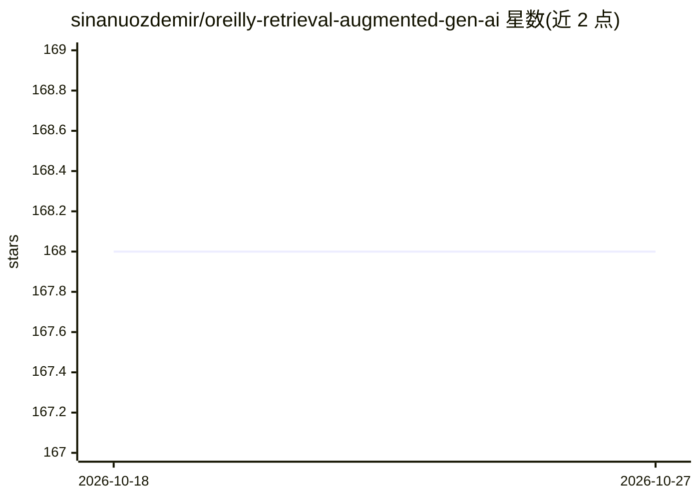

# sinanuozdemir/oreilly-retrieval-augmented-gen-ai

⭐ 168 · Jupyter Notebook · 推送 2026-02-17 · [GitHub](https://github.com/sinanuozdemir/oreilly-retrieval-augmented-gen-ai) · [官网](https://learning.oreilly.com/live-events/retrieval-augmented-generation-rag-and-agents-using-llms/0642572007797) · 个人维护

**RAG 与 Agent 的教学代码仓库（O'Reilly 视频配套）**

配套 O'Reilly 平台视频与作者 LLM 图书的教学代码库，用 Jupyter notebook 演示如何用实时数据增强 LLM：涵盖向量数据库检索、语义搜索、嵌入微调、RAG 聊天机器人、FastAPI+Streamlit 应用、LangGraph 端到端 RAG 工作流（含评分组件与合成测试数据评估）、基于 Neo4J 与 Cohere Re-Rank 的 GraphRAG、以及 CLIP 多模态图像检索。需配置 OpenAI/Pinecone/Anthropic/Gemini/Cohere 等多个 API key 后在虚拟环境中运行。

## 筛选速览

| 维度 | 判定 | 备注 |
|---|---|---|
| AI 角色 | `ai-knowledge` | 知识聚合/清单类 |
| 许可风险 | `none` | — |
| 部署形态 | `library` | 以包/库形式分发 |
| 模型依赖 | — | README 未给出锁定关系 |
| 硬件要求 | — | 无带数字的原话,不猜 |
| 安装摩擦 | `low` | 无编译、无系统依赖或容器化 |
| 成熟度 | — | 结构信号不足 |

## 能力要点

- 覆盖 RAG 检索/生成、语义搜索与嵌入微调的系列 notebook
- LangGraph 端到端 RAG 工作流（含评分与合成测试数据评估）
- 基于 Neo4J + Cohere Re-Rank + GPT-4o 的 GraphRAG 示例
- CLIP 多模态图像检索与 FastAPI/Streamlit 应用示例

## 适用场景

- 跟着 notebook 学习 RAG 从检索到生成的完整流程
- 参考 LangGraph 工作流与评估代码搭建自己的 RAG 项目
- 了解 GraphRAG 与多模态检索的实现方式

## 场景标签

`教程课程` `RAG` · 领域:知识与检索

## 证据(README 行号)

> L3: Welcome to the "Retrieval-Augmented Generation (RAG) and Agents Using LLMs" code repository! In this repo, we begin 
> L46: This project contains several Jupyter notebooks each focusing on a specific topic:

## 星数曲线

2026-10-18 168 → 2026-10-27 168（+0）

---
*卡片 v1 · prompt 1.4 · 生成 2026-10-22 · 置信度 high · 依据 README sha `b6bff50cbf6a` · [字段定义](../../DATASET.md)*
