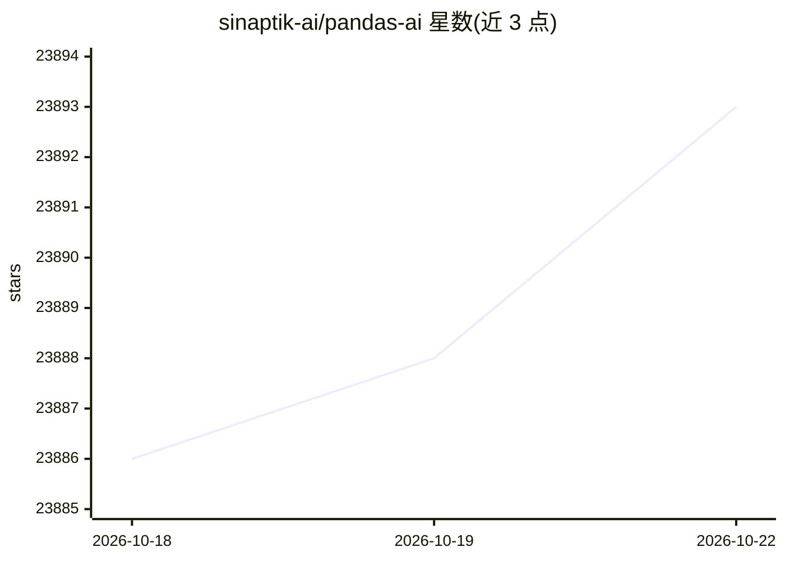

# sinaptik-ai/pandas-ai

⭐ 23,893 · Python · NOASSERTION · 推送 2025-10-28 · [GitHub](https://github.com/sinaptik-ai/pandas-ai) · [官网](https://pandas-ai.com) · 组织维护

**用自然语言对话查询数据库与数据文件的 Python 库**

PandasAI 是一个 Python 库，通过 LLM 让用户以自然语言向数据提问，支持 SQL、CSV、parquet 等数据源。定位为帮助非技术用户以更自然的方式与数据交互，也帮助技术用户节省时间。提供 df.chat 接口提问、生成图表、多 DataFrame 关联问答；可通过 pandasai-docker 在 Docker 沙箱中隔离执行生成的代码。安装依赖 Python 3.8–3.11，pip 或 poetry 安装，LLM 接入经 pandasai-litellm 扩展包。仓库 ee 目录另有单独许可。

## 筛选速览

| 维度 | 判定 | 备注 |
|---|---|---|
| AI 角色 | `ai-native` | 本体是模型或模型工具 |
| 许可风险 | `dual` | NOASSERTION |
| 部署形态 | `library` | 以包/库形式分发 |
| 模型依赖 | — | README 未给出锁定关系 |
| 硬件要求 | — | 无带数字的原话,不猜 |
| 安装摩擦 | `low` | 无编译、无系统依赖或容器化 |
| 成熟度 | — | 结构信号不足 |

## 动量与使用信号

- 维护:`declining` — 距上次 push 354.9 天,年发版 0,109 位贡献者
- 涨星:近 1 天 **+7**(自 20261016 起算)
- 安装:pypi 包 `pandasai` 月下载 31,394

## 能力要点

- df.chat 自然语言提问数据并返回文本答案
- 按自然语言指令生成图表（直方图等）
- 多个 DataFrame 关联查询
- Docker 沙箱隔离执行代码（pandasai-docker）

## 适用场景

- 用自然语言查询 SQL 数据库或 CSV/parquet 文件
- 非技术成员自助做数据分析
- 让模型按描述生成数据可视化图表
- 在隔离沙箱中安全执行 LLM 生成的分析代码

## 场景标签

`数据分析` · 领域:效率与自动化

## 证据(README 行号)

> L11: PandasAI is a Python library that makes it easy to ask questions to your data in natural language. It helps non-tec
> L93: You can run PandasAI in a Docker sandbox, providing a secure, isolated environment to execute code safely and mitig

## 星数曲线

2026-10-18 23,886 → 2026-10-22 23,893（+7）

---
*卡片 v1 · prompt 1.4 · 生成 2026-10-18 · 置信度 high · 依据 README sha `21eae0eadf9f` · [字段定义](../../DATASET.md)*
