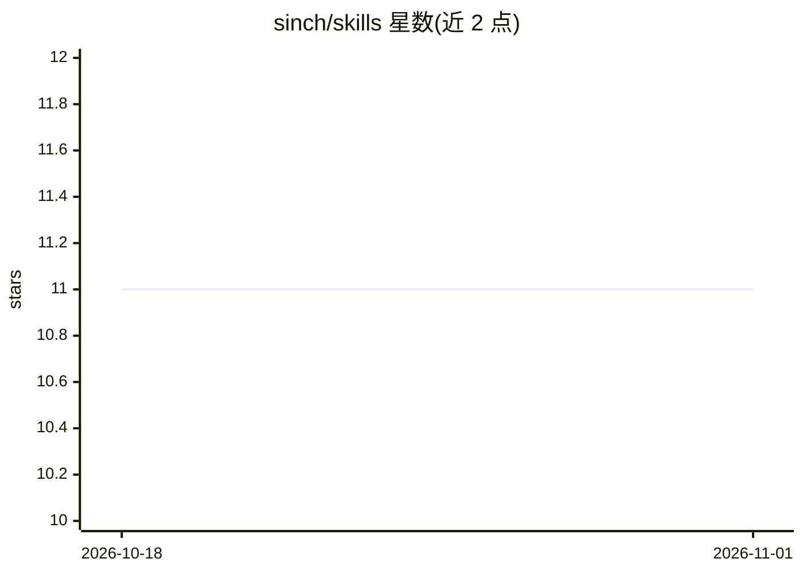

# sinch/skills

⭐ 11 · JavaScript · Apache-2.0 · 推送 2026-10-03 · [GitHub](https://github.com/sinch/skills) · [官网](https://sinch.com/) · 组织维护

**Sinch 通信 API 的 AI agent 技能集，供编码助手调用**

Sinch 官方维护的 AI agent 技能库：以 SKILL.md 文件为载体，向 AI 编码助手提供 Sinch 通信 API 的入门指引、最佳实践与常见陷阱，覆盖认证、SDK 初始化、短信/WhatsApp/RCS、语音、号码管理、验证、Mailgun 邮件、CLI 与 Functions 等 20 余个技能，每个技能含概览、关键概念与参考链接等结构化章节。通过 npx skills add sinch/skills 安装，也可经 Sinch Plugins 安装；使用需有效 Sinch 账户并受其服务条款约束，Apache-2.0 许可。

## 筛选速览

| 维度 | 判定 | 备注 |
|---|---|---|
| AI 角色 | `ai-knowledge` | 知识聚合/清单类 |
| 许可风险 | `permissive` | Apache-2.0 |
| 部署形态 | `library` | 以包/库形式分发 |
| 模型依赖 | — | README 未给出锁定关系 |
| 硬件要求 | — | 无带数字的原话,不猜 |
| 安装摩擦 | `medium` | 含编译或系统依赖之一 |
| 成熟度 | — | 结构信号不足 |

## 能力要点

- 20 余个按 Core/Messaging/Voice/Numbers 等类别组织的 Sinch API 技能
- SKILL.md 结构：YAML frontmatter + Overview/Getting Started/Gotchas 等章节
- 可含 scripts、references、assets 辅助文件
- 支持 npx skills add 一条命令安装

## 适用场景

- 在 AI 编码助手中集成 Sinch SMS/WhatsApp/语音等 API 开发知识
- 开发多渠道消息或语音应用时让 agent 提示正确调用方式与陷阱
- 团队为 Sinch 相关项目提供统一的技能参考

## 场景标签

`提示工程` · 领域:Agent 开发

## 证据(README 行号)

> L3: AI agent skills for Sinch communication APIs. Get expert guidance on getting started, best practices, and gotchas --

## 星数曲线

2026-10-18 11 → 2026-11-01 11（+0）

---
*卡片 v1 · prompt 1.4 · 生成 2026-11-01 · 置信度 high · 依据 README sha `160d3465b120` · [字段定义](../../DATASET.md)*
