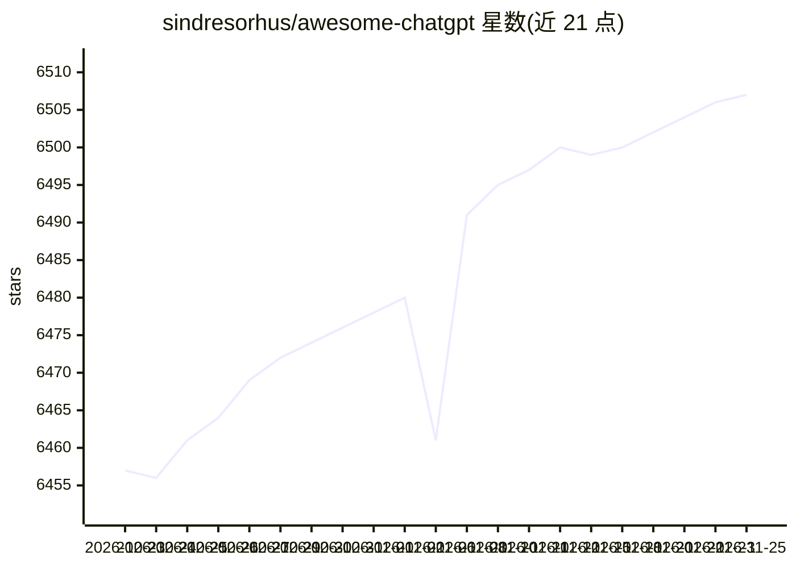

# sindresorhus/awesome-chatgpt

⭐ 6,507 · CC0-1.0 · 推送 2026-11-15 · [GitHub](https://github.com/sindresorhus/awesome-chatgpt) · 个人维护

**面向 ChatGPT 用户的工具与资源聚合清单**

Awesome 系列清单，收录围绕 ChatGPT 的第三方资源：macOS/iOS/Windows 客户端、托管与自托管 Web 应用、浏览器扩展与用户脚本、CLI 工具、多平台聊天机器人、IDE/办公软件集成、API 客户端库及文章教程。条目按类别组织，部分商业条目以 ($) 标注。README 当前声明因低质量提交过多暂停收录提交，清单由 sindresorhus 维护。

## 筛选速览

| 维度 | 判定 | 备注 |
|---|---|---|
| AI 角色 | `ai-knowledge` | 知识聚合/清单类 |
| 许可风险 | `viral` | CC0-1.0 |
| 部署形态 | `None` |  |
| 模型依赖 | — | README 未给出锁定关系 |
| 硬件要求 | — | 无带数字的原话,不猜 |
| 安装摩擦 | `low` | 无编译、无系统依赖或容器化 |
| 成熟度 | — | 结构信号不足 |

## 能力要点

- 分类收录桌面/移动端 ChatGPT 客户端约 30 个
- 含浏览器扩展、用户脚本与书签脚本小节
- CLI 工具覆盖提交信息生成、文档生成等用途
- 列出多语言 API 客户端（Swift/Node.js/Go/PHP 等）

## 适用场景

- 寻找可自托管的 ChatGPT 替代 Web UI
- 为浏览器或 IDE 找 ChatGPT 集成扩展
- 查找自动生成 Git 提交信息的命令行工具

## 场景标签

`精选清单` · 领域:学习与行业

## 证据(README 行号)

> L1: Awesome ChatGPT
> L9: ## Contents
> L245: ## Articles

## 星数曲线

2026-10-23 6,457 → 2026-11-25 6,507（+50）

---
*卡片 v1 · prompt 1.4 · 生成 2026-11-22 · 置信度 high · 依据 README sha `6638be0b5047` · [字段定义](../../DATASET.md)*
