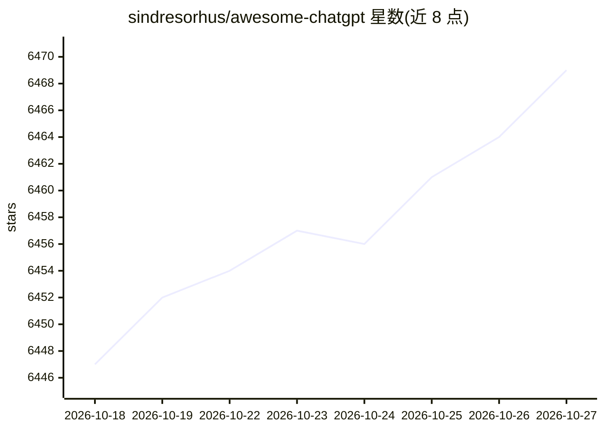

# sindresorhus/awesome-chatgpt

⭐ 6,469 · CC0-1.0 · 推送 2026-02-15 · [GitHub](https://github.com/sindresorhus/awesome-chatgpt) · 个人维护

**ChatGPT 相关工具与项目策展清单**

由 sindresorhus 维护的 awesome list，围绕 OpenAI 的 ChatGPT 聊天机器人收录第三方生态资源：桌面与移动应用、托管/自托管 Web 应用、浏览器扩展、CLI 工具、各平台机器人、编辑器与办公软件集成、多语言 API 客户端与库。条目附一句话简介与收费/开源标注。仓库为纯清单，不提供可运行代码；README 顶部标注条目提交因低质量投稿过多而暂停。

## 筛选速览

| 维度 | 判定 | 备注 |
|---|---|---|
| AI 角色 | `ai-knowledge` | 知识聚合/清单类 |
| 许可风险 | `viral` | CC0-1.0 |
| 部署形态 | `None` |  |
| 模型依赖 | — | README 未给出锁定关系 |
| 硬件要求 | — | 无带数字的原话,不猜 |
| 安装摩擦 | `low` | 无编译、无系统依赖或容器化 |
| 成熟度 | — | 结构信号不足 |

## 能力要点

- 覆盖 Apps/Web/扩展/CLI/Bots/集成/包等约 10 大类生态条目
- 标注条目收费($)与开源状态、平台（Electron/macOS/iOS 等）
- 收录 Swift/Node.js/Go/Delphi/PHP/Ruby 等多语言 API 客户端

## 适用场景

- 寻找 ChatGPT 的桌面客户端、浏览器扩展或 CLI 工具
- 查找各编程语言的 ChatGPT API 客户端库
- 了解 ChatGPT 周边应用与集成生态的条目分布

## 场景标签

`精选清单` · 领域:学习与行业

## 证据(README 行号)

> L1: Awesome ChatGPT
> L3:  ChatGPT is an artificial intelligence (AI) chatbot developed by OpenAI

## 星数曲线

2026-10-18 6,447 → 2026-10-27 6,469（+22）

---
*卡片 v1 · prompt 1.4 · 生成 2026-10-20 · 置信度 high · 依据 README sha `b1d2a6528d22` · [字段定义](../../DATASET.md)*
