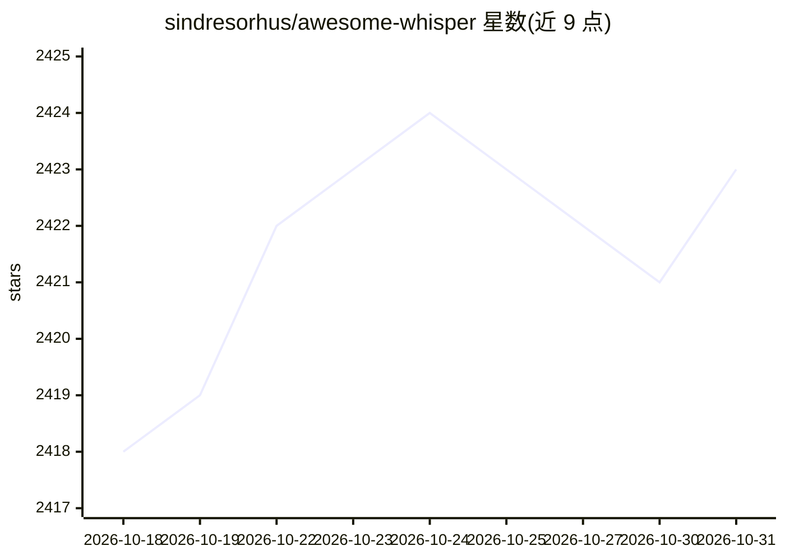

# sindresorhus/awesome-whisper

⭐ 2,423 · CC0-1.0 · 推送 2026-09-17 · [GitHub](https://github.com/sindresorhus/awesome-whisper) · 个人维护

**Whisper 语音识别生态的策展清单：模型变体、应用与工具**

由 sindresorhus 维护的 Whisper 语音识别项目聚合清单：Whisper 是 OpenAI 开发的开源语音识别系统。清单按官方资源、模型变体（whisper.cpp、WhisperX、faster-whisper 等）、桌面/Web 应用、CLI 工具、Playground 演示、代码包、文章与视频、社区及第三方 API 等类别组织条目，条目多标注平台与许可证信息（FOSS/Freemium/Source-available）。面向需要检索 Whisper 相关工具与资源的开发者和用户。

## 筛选速览

| 维度 | 判定 | 备注 |
|---|---|---|
| AI 角色 | `ai-knowledge` | 知识聚合/清单类 |
| 许可风险 | `viral` | CC0-1.0 |
| 部署形态 | `None` |  |
| 模型依赖 | — | README 未给出锁定关系 |
| 硬件要求 | — | 无带数字的原话,不猜 |
| 安装摩擦 | `low` | 无编译、无系统依赖或容器化 |
| 成熟度 | — | 结构信号不足 |

## 能力要点

- 收录官方资源、白皮书与源码入口
- 模型变体覆盖 C++/JAX/CTranslate2/OpenVINO/TFLite 等实现
- 按 Apps、Web apps、CLI、Playgrounds、Packages 等类别组织
- 条目标注平台与许可证信息

## 适用场景

- 为语音转文字需求挑选 Whisper 实现或应用
- 查找带说话人分离、词级时间戳等特性的变体
- 了解 Whisper 的自托管部署与 API 选项

## 场景标签

`精选清单` · 领域:学习与行业

## 证据(README 行号)

> L1: Awesome Whisper
> L3:  Whisper is an open-source AI-powered speech recognition system developed by OpenAI
> L17: ## Model variants

## 星数曲线

2026-10-18 2,418 → 2026-10-31 2,423（+5）

---
*卡片 v1 · prompt 1.4 · 生成 2026-10-21 · 置信度 high · 依据 README sha `b710c3561e53` · [字段定义](../../DATASET.md)*
