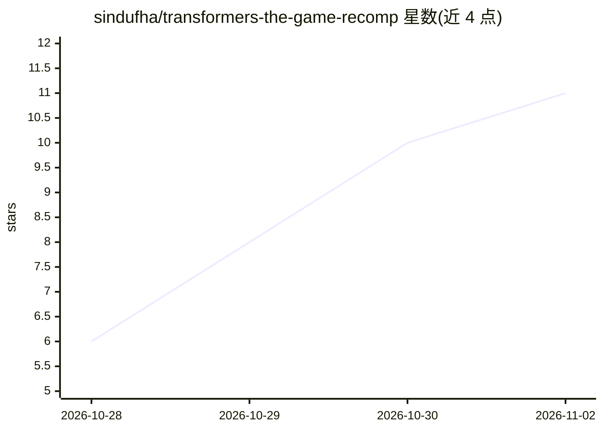

# sindufha/transformers-the-game-recomp

⭐ 11 · 推送 2026-10-24 · [GitHub](https://github.com/sindufha/transformers-the-game-recomp) · [官网](https://github.com/sindufha/transformers-the-game-recomp/releases) · 个人维护

**《变形金刚》PC 版静态重编译移植到 Android 的实验性 APK**

将 PC 版《Transformers: The Game》通过静态 x86 重编译生成原生代码，配合 Windows API 兼容层、DXVK Native/Vulkan 渲染与 AAudio 音频，在 Android 上运行。提供 ARM64/ARMv7/Universal 三种实验性预览 APK，需用户自备合法 PC 版游戏文件（约 4.35 GB 导入数据）。实现触屏机器人/载具操控、图形设置、后台恢复等；源码未公开，Bink 视频播放等仍受限，非官方项目。项目本身不含 AI 功能。

## 筛选速览

| 维度 | 判定 | 备注 |
|---|---|---|
| AI 角色 | `ai-enhanced` | 去掉 AI 部分产品仍成立 |
| 许可风险 | `none` | — |
| 部署形态 | `None` |  |
| 模型依赖 | — | README 未给出锁定关系 |
| 硬件要求 | — | 无带数字的原话,不猜 |
| 安装摩擦 | `low` | 无编译、无系统依赖或容器化 |
| 成熟度 | `idea` | |

## 能力要点

- 静态 x86 重编译生成原生游戏代码，DXVK Native/Vulkan 渲染、AAudio 输出原版音频
- 机器人/载具触屏操控布局与启动器图形设置（含 343 条缓存着色器）
- 三种架构 APK 预览包，校验并导入用户自备的 PC 游戏文件

## 适用场景

- 在 Android 设备上游玩自己拥有的 PC 版《变形金刚》
- 跟踪静态重编译移植技术在移动端的实验进展
- 在支持的 Vulkan 设备上体验预览版战役关卡

## 场景标签

 · 领域:游戏移植/模拟兼容

## 证据(README 行号)

> L12: An experimental Android port of the PC version of **Transformers: The Game**.
> L13: Static x86 recompilation supplies native game code; a Windows API compatibility

## 星数曲线

2026-10-28 6 → 2026-11-02 11（+5）

---
*卡片 v1 · prompt 1.4 · 生成 2026-11-02 · 置信度 low · 依据 README sha `1c8fea8ac7d1` · [字段定义](../../DATASET.md)*
