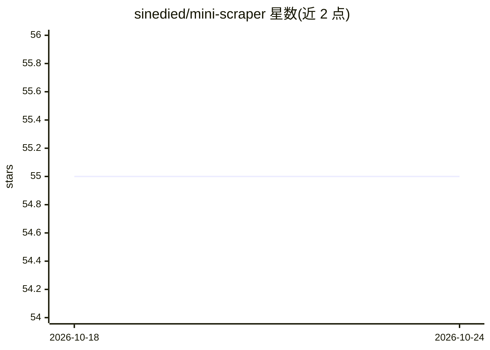

# sinedied/mini-scraper

⭐ 55 · TypeScript · MIT · 推送 2026-07-31 · [GitHub](https://github.com/sinedied/mini-scraper) · 个人维护

**给掌机模拟器 ROM 抓取盒绘封面的 CLI 工具，可选 AI 匹配**

面向 MinUI、NextUI、muOS、Anbernic 等模拟器前端/掌机系统的命令行刮削工具：从 libretro 缩略图源抓取 ROM 的盒绘、截图或标题图，无需账号与配置，按目标设备输出对应格式并指定最大宽度。可选开启 AI 匹配，通过 OpenAI 兼容接口调用本地 Ollama（默认 gemma2:2b，可自动拉取模型）或 LM Studio、OpenAI API 等端点，以提升匹配准确度；未拉取模型时提示下载，需鉴权的远端服务用 API key。支持 npm 全局安装与 Docker 运行，覆盖 50 余种游戏系统。

## 筛选速览

| 维度 | 判定 | 备注 |
|---|---|---|
| AI 角色 | `ai-enhanced` | 去掉 AI 部分产品仍成立 |
| 许可风险 | `permissive` | MIT |
| 部署形态 | `self-host` | docker 或自建部署 |
| 模型依赖 | local-ok | 支持本地模型 |
| 硬件要求 | — | 无带数字的原话,不猜 |
| 安装摩擦 | `low` | 无编译、无系统依赖或容器化 |
| 成熟度 | — | 结构信号不足 |

## 能力要点

- 从 libretro 缩略图源抓取，无需账号
- 支持 minui/nextui/muos/anbernic/funkey/onion 六种输出格式
- 可选 AI 高级匹配，兼容任意 OpenAI 兼容端点，默认本地 Ollama
- 提供 Docker 运行方式，覆盖 50+ 游戏系统

## 适用场景

- 给掌机模拟器系统的 ROM 批量补充盒绘封面
- 中文名或变体较多的 ROM 用 AI 提升封面匹配准确度
- 不想本地装 Node.js 时用 Docker 运行刮削

## 场景标签

`网页抓取` · 领域:效率与自动化

## 证据(README 行号)

> L11: Artwork scraper for MinUI, NextUI, muOS, and others.
> L19: - Optionally uses local AI (via Ollama or any OpenAI-compatible API) for better boxart matching

## 星数曲线

2026-10-18 55 → 2026-10-24 55（+0）

---
*卡片 v1 · prompt 1.4 · 生成 2026-10-24 · 置信度 high · 依据 README sha `7b77d060ee6c` · [字段定义](../../DATASET.md)*
