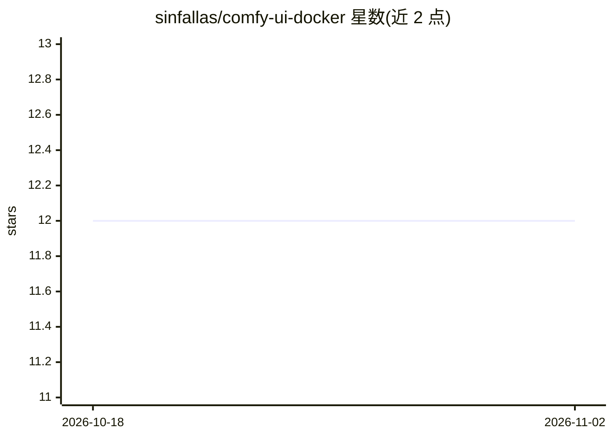

# sinfallas/comfy-ui-docker

⭐ 12 · Shell · GPL-2.0 · 推送 2026-09-20 · [GitHub](https://github.com/sinfallas/comfy-ui-docker) · [官网](https://hub.docker.com/r/sinfallas/comfyui) · 个人维护

**ComfyUI 的非官方 Docker 镜像封装**

将 ComfyUI（节点式 Stable Diffusion 图形界面）打包为非官方 Docker 镜像发布于 Docker Hub。镜像 TAG 对应 ComfyUI 的发布版本号与 GPU 架构（nvidia/amd/intel），用户通过仓库提供的 docker-compose.yml 文件启动容器，从 Docker Hub 拉取 sinfallas/comfyui 镜像运行。README 仅含运行与获取方式说明，未描述额外功能或配置细节。

## 筛选速览

| 维度 | 判定 | 备注 |
|---|---|---|
| AI 角色 | `ai-ecosystem` | LLM/agent 周边工具 |
| 许可风险 | `viral` | GPL-2.0 |
| 部署形态 | `None` |  |
| 模型依赖 | — | README 未给出锁定关系 |
| 硬件要求 | — | 无带数字的原话,不猜 |
| 安装摩擦 | `low` | 无编译、无系统依赖或容器化 |
| 成熟度 | — | 结构信号不足 |

## 能力要点

- 镜像 TAG 同时标识 ComfyUI 版本与 GPU 架构（nvidia/amd/intel）
- 提供 docker-compose.yml 用于启动
- 镜像发布于 Docker Hub（sinfallas/comfyui）

## 适用场景

- 用 Docker 快速部署 ComfyUI 环境
- 在不同 GPU 架构上选择对应镜像标签运行 ComfyUI

## 场景标签

`图像生成` · 领域:内容生成

## 证据(README 行号)

> L1: # unofficial comfy-ui docker image
> L5: The TAG corresponds to the release version of comfy-ui and the GPU (nvidia,amd,intel)
> L7: To run use the **docker-compose.yml** file

## 星数曲线

2026-10-18 12 → 2026-11-02 12（+0）

---
*卡片 v1 · prompt 1.4 · 生成 2026-11-01 · 置信度 high · 依据 README sha `d41fcc29de2e` · [字段定义](../../DATASET.md)*
