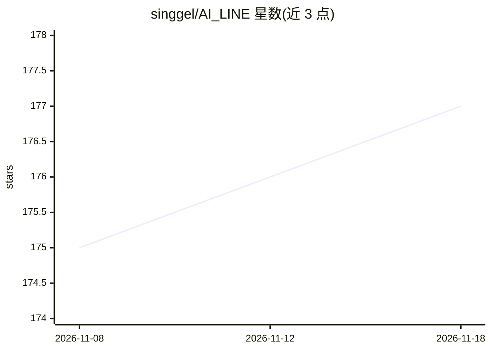

# singgel/AI_LINE

⭐ 177 · 推送 2026-04-07 · [GitHub](https://github.com/singgel/AI_LINE) · 个人维护 · 中文 README

**机器学习与深度学习书籍资料链接的个人收藏清单**

个人维护的 AI 学习资料聚合仓库：以书名条目形式罗列《算法图解》《Tensorflow 实战Google深度学习框架》《机器学习实战》《统计学习方法》等机器学习与深度学习书籍，部分条目附 d2l 在线教材链接、CSDN 下载链接以及一个 SpringBoot 集成 Ollama 的外部示例仓库链接。不包含代码实现或工具，仅为链接集合，覆盖深度学习、推荐系统、Python 数据采集等主题。

## 筛选速览

| 维度 | 判定 | 备注 |
|---|---|---|
| AI 角色 | `ai-knowledge` | 知识聚合/清单类 |
| 许可风险 | `none` | — |
| 部署形态 | `None` |  |
| 模型依赖 | — | README 未给出锁定关系 |
| 硬件要求 | — | 无带数字的原话,不猜 |
| 安装摩擦 | `low` | 无编译、无系统依赖或容器化 |
| 成熟度 | — | 结构信号不足 |

## 能力要点

- 罗列十余本机器学习/深度学习中文书籍条目
- 部分条目附在线阅读或 CSDN 下载链接
- 含《动手学深度学习》在线教材链接

## 适用场景

- 查找机器学习入门与进阶书籍线索
- 收集深度学习中文学习资料入口

## 场景标签

`精选清单` · 领域:学习与行业

## 证据(README 行号)

> L7: * 《算法图解》
> L9: * 《Tensorflow 实战Google深度学习框架》
> L15: * 《统计学习方法》

## 星数曲线

2026-11-08 175 → 2026-11-18 177（+2）

---
*卡片 v1 · prompt 1.4 · 生成 2026-11-17 · 置信度 high · 依据 README sha `27447bd6ed8b` · [字段定义](../../DATASET.md)*
