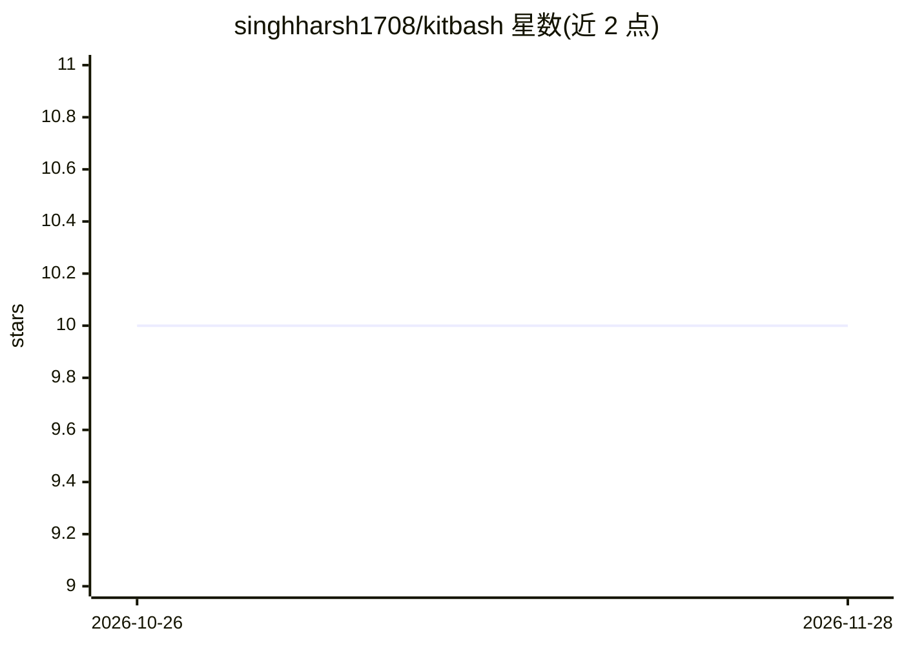

# singhharsh1708/kitbash

⭐ 10 · HTML · Apache-2.0 · 推送 2026-11-07 · [GitHub](https://github.com/singhharsh1708/kitbash) · [官网](https://singhharsh1708.github.io/kitbash/) · 个人维护

**AI agent 技能的包管理器与编译器：一次编写编译到 11 个 agent**

将 KSF 开放格式编写的技能编译为 Claude Code、Cursor、Copilot、Zed、Cline、Devin、Gemini CLI、Aider 等十个 agent 的原生格式（外加 Agent Plugins 打包格式），并在编译时测量每个输出的常驻 token 成本（每次会话占用上下文的量）。安全机制包括四条不可绕过的安装 lint（隐藏文本、动态执行、远程执行、凭据）、内容哈希 lockfile、doctor 漂移检查与 [policy] 来源允许清单。零运行时依赖，Node 20+，通过 npm 或 Homebrew 安装。

## 筛选速览

| 维度 | 判定 | 备注 |
|---|---|---|
| AI 角色 | `ai-ecosystem` | LLM/agent 周边工具 |
| 许可风险 | `permissive` | Apache-2.0 |
| 部署形态 | `library` | 以包/库形式分发 |
| 模型依赖 | — | README 未给出锁定关系 |
| 硬件要求 | — | 无带数字的原话,不猜 |
| 安装摩擦 | `low` | 无编译、无系统依赖或容器化 |
| 成熟度 | `idea` | |

## 能力要点

- 一套 KSF 源编译到 11 个 agent 目标，其中 9 个支持懒加载
- 编译时测量技能的常驻 token 成本并给出分目标基准表
- 四条安全 lint 硬门 + 内容哈希 lockfile + org 允许清单
- 为六个目标生成 MCP 服务器原生配置并合并而非覆盖

## 适用场景

- 团队统一维护一套技能源，避免逐 agent 手写副本
- 安装第三方技能前预览其编译输出与 token 成本
- 审计组织中可安装的技能来源与权限

## 场景标签

`提示工程` · 领域:Agent 开发

## 证据(README 行号)

> L5: Kitbash is a compiler for AI agent skills that measures what a skill costs your context window every session — befor
> L7: You write the skill once in one open format (KSF) and compile it to the native format of ten coding agents — Claude 
> L53: **Status.** v0.24.1, on npm and Homebrew, zero runtime dependencies, Node 20+. The KSF core is frozen and additive-

## 星数曲线

2026-10-26 10 → 2026-11-28 10（+0）

---
*卡片 v1 · prompt 1.4 · 生成 2026-11-19 · 置信度 high · 依据 README sha `11e6f3f36a78` · [字段定义](../../DATASET.md)*
