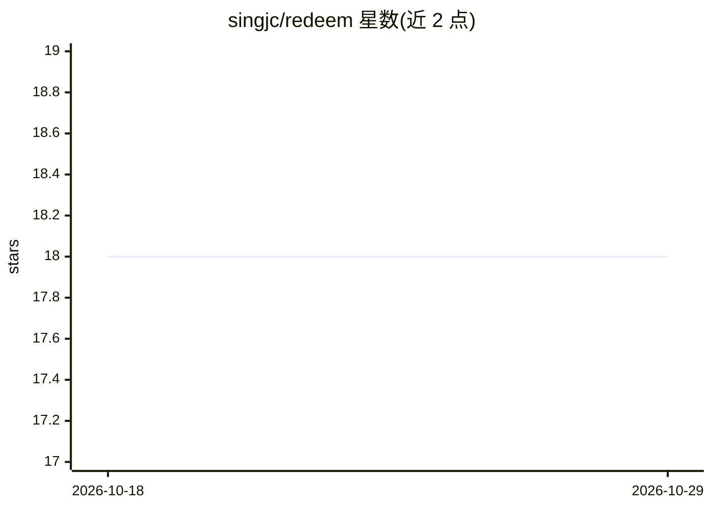

# singjc/redeem

⭐ 18 · Rust · BSD-3-Clause · 推送 2026-10-21 · [GitHub](https://github.com/singjc/redeem) · 个人维护

**质谱蛋白质组学深度学习模型库（Rust），预测肽段性质**

Rust workspace 形式的质谱蛋白质组学库，提供基于 candle 的深度学习模型预测肽段性质（保留时间 RT、碰撞截面 CCS、MS2 谱图），以及半监督 PSM 重打分的机器学习分类器（GBDT、XGBoost、SVM）。定位为供其他工具（如 Sage）调用的库，同时通过 PyO3 提供 Python 绑定，默认加载预训练模型，支持 pandas/polars DataFrame 输出；另提供 OpenMS 集成的 C ABI 静态库与 CMake 接入方式。部分 crate（如 redeem-classifiers）尚未发布到 crates.io。

## 筛选速览

| 维度 | 判定 | 备注 |
|---|---|---|
| AI 角色 | `ai-native` | 本体是模型或模型工具 |
| 许可风险 | `permissive` | BSD-3-Clause |
| 部署形态 | `library` | 以包/库形式分发 |
| 模型依赖 | — | README 未给出锁定关系 |
| 硬件要求 | — | 无带数字的原话,不猜 |
| 安装摩擦 | `medium` | 含编译或系统依赖之一 |
| 成熟度 | `idea` | |

## 能力要点

- 基于 candle 的肽段性质预测（RT、CCS、MS2）
- 半监督 PSM 重打分分类器（GBDT/XGBoost/SVM）
- PyO3 Python 绑定与 pandas/polars 输出支持
- OpenMS FFI 静态库与 WITH_REDEEM CMake 集成

## 适用场景

- 在蛋白质组学搜库工具中集成肽段性质预测
- 用 Python 调用预训练模型生成 RT/CCS/MS2 预测
- 对 PSM 结果做半监督重打分

## 场景标签

 · 领域:生物信息学/蛋白质组学

## 证据(README 行号)

> L9: ReDeeM is a Rust workspace for mass spectrometry proteomics, providing deep learning models for peptide property pre
> L18: |`redeem-properties`|Peptide property prediction (RT, CCS, MS2) using candle|Crates.io|README|

## 星数曲线

2026-10-18 18 → 2026-10-29 18（+0）

---
*卡片 v1 · prompt 1.4 · 生成 2026-10-29 · 置信度 high · 依据 README sha `f5020634dc8c` · [字段定义](../../DATASET.md)*
