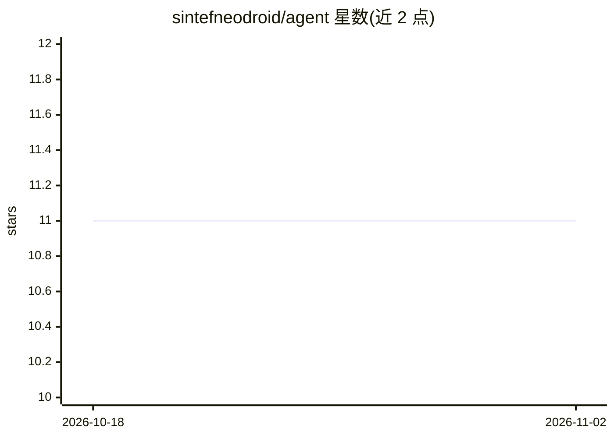

# sintefneodroid/agent

⭐ 11 · Python · Apache-2.0 · 推送 2026-10-12 · [GitHub](https://github.com/sintefneodroid/agent) · [官网](https://pypi.org/project/Neodroid/) · 个人维护

**Neodroid 平台环境上的强化学习智能体算法实现集合**

面向 Neodroid 平台（受挪威研究理事会资助）的机器学习智能体代码库：实现 DQN 系列变体、DDPG、TD3、SAC、PPO、A3C/A2C、分层强化学习等 16 种强化学习算法，以及 Bit Flipping、Four Rooms、Ant-Maze 等实验环境。基于 PyTorch 编写，通过 procedures 目录下的脚本进行训练与测试，需 export PYTHONPATH 指向仓库根目录。包含 Target Point Estimator 与 Perfect Information Navigator 两类任务的实验结果展示。

## 筛选速览

| 维度 | 判定 | 备注 |
|---|---|---|
| AI 角色 | `ai-native` | 本体是模型或模型工具 |
| 许可风险 | `permissive` | Apache-2.0 |
| 部署形态 | `library` | 以包/库形式分发 |
| 模型依赖 | — | README 未给出锁定关系 |
| 硬件要求 | — | 无带数字的原话,不猜 |
| 安装摩擦 | `low` | 无编译、无系统依赖或容器化 |
| 成熟度 | — | 结构信号不足 |

## 能力要点

- 实现 16 种强化学习算法（DQN 系列/DDPG/TD3/SAC/PPO 等）
- 自带 Bit Flipping、Four Rooms、Ant-Maze 等实验环境
- 提供 train_agent.py / test_agent.py 训练与测试脚本
- 基于 PyTorch，附论文出处引用

## 适用场景

- 在 Neodroid 平台环境中训练强化学习智能体
- 参考多种 RL 算法的 PyTorch 实现与实验结果
- 复现 HER、分层强化学习等经典算法实验

## 场景标签

`强化学习` · 领域:训练与推理

## 证据(README 行号)

> L5: This repository will host all initial machine learning efforts applying the Neodroid platform.
> L46: 1. *Deep Q Learning (DQN)* (Mnih et al. 2013)

## 星数曲线

2026-10-18 11 → 2026-11-02 11（+0）

---
*卡片 v1 · prompt 1.4 · 生成 2026-11-01 · 置信度 mid · 依据 README sha `1b23c48bfcc1` · [字段定义](../../DATASET.md)*
