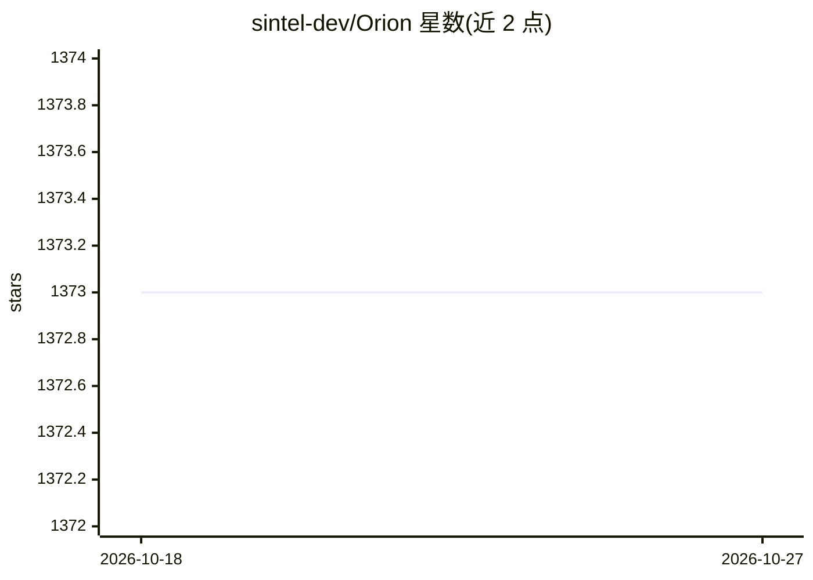

# sintel-dev/Orion

⭐ 1,373 · Python · MIT · 推送 2026-10-19 · [GitHub](https://github.com/sintel-dev/Orion) · [官网](https://sintel.dev/Orion/) · 组织维护

**MIT 实验库：无监督时间序列异常检测**

Data to AI Lab at MIT 开发的 Python 机器学习库，面向无监督时间序列异常检测：提供多个经验证的 ML 流水线（AER、TadGAN、LSTM 自编码器、VAE 等），对时间序列数据识别稀有模式并标记供专家复核，输出含 start/end/severity 的 pandas DataFrame。每次发布在 12 个带真值数据集上跑基准并维护流水线排行榜，附 Colab notebooks、文档与 Slack 社区。AER、TadGAN 及 Sintel 框架均有论文可供引用。

## 筛选速览

| 维度 | 判定 | 备注 |
|---|---|---|
| AI 角色 | `ai-native` | 本体是模型或模型工具 |
| 许可风险 | `permissive` | MIT |
| 部署形态 | `library` | 以包/库形式分发 |
| 模型依赖 | — | README 未给出锁定关系 |
| 硬件要求 | — | 无带数字的原话,不猜 |
| 安装摩擦 | `low` | 无编译、无系统依赖或容器化 |
| 成熟度 | — | 结构信号不足 |

## 能力要点

- 提供经验证的无监督异常检测流水线（AER、TadGAN、LSTM Autoencoder、VAE、GANF 等）
- 统一 API：fit 后对新数据 detect，输出含 severity 的异常表
- 每次发布在 12 个带真值数据集上运行基准并维护流水线排行榜
- 基于 Data to AI Lab 的自动化机器学习工具构建

## 适用场景

- 在传感器、信号等时间序列数据上检测异常区间
- 对比多种异常检测流水线在自有数据上的表现
- 研究者复现或引用 AER/TadGAN 异常检测方法

## 场景标签

 · 领域:机器学习/时间序列分析

## 证据(README 行号)

> L12: A machine learning library for unsupervised time series anomaly detection.
> L25: Orion is a machine learning library built for *unsupervised time series anomaly detection*. With a given time serie

## 星数曲线

2026-10-18 1,373 → 2026-10-27 1,373（+0）

---
*卡片 v1 · prompt 1.4 · 生成 2026-10-21 · 置信度 high · 依据 README sha `77f6a9927c41` · [字段定义](../../DATASET.md)*
