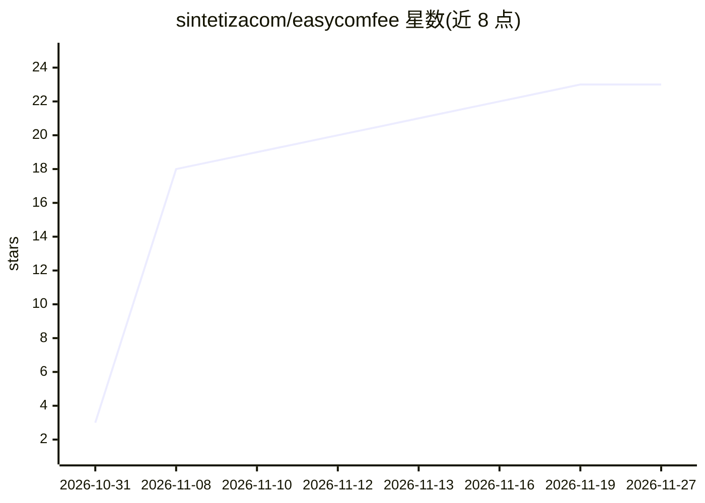

# sintetizacom/easycomfee

⭐ 23 · Python · MIT · 推送 2026-11-16 · [GitHub](https://github.com/sintetizacom/easycomfee) · 组织维护

**面向创作者的 ComfyUI 一键式图像/视频/音频生成工作室**

在 ComfyUI 之上提供单提示词界面的开源创作应用：用户选择模式、输入文字或拖入文件即可生成，无需操作节点图（Advanced 标签保留完整节点编辑器）。功能覆盖文生图、照片编辑 12 项工具、文/图生视频、LTX 工作流、对口型、音乐与语音，核心基于 Lightricks 开源 LTX 模型。内置安装器按功能自动下载所需模型与自定义节点，可运行在本地 NVIDIA GPU，也可切换 Comfy Cloud；小显存显卡可选轻量模型包。Windows 提供一键安装。

## 筛选速览

| 维度 | 判定 | 备注 |
|---|---|---|
| AI 角色 | `ai-native` | 本体是模型或模型工具 |
| 许可风险 | `permissive` | MIT |
| 部署形态 | `desktop` | 安装包/桌面程序 |
| 模型依赖 | — | README 未给出锁定关系 |
| 硬件要求 | `gpu-8g` | |
| 安装摩擦 | `medium` | 含编译或系统依赖之一 |
| 成熟度 | `idea` | |

## 能力要点

- 单提示词界面封装 ComfyUI，Advanced 模式保留节点图
- 内置模型安装器按功能下载所需模型与自定义节点
- 本地 GPU 免费/私密与 Comfy Cloud 付费双路径，生成前显示价格
- 3D 块模型（Blender/Unreal blockout）经 layout-to-render IC-LoRA 转为成片

## 适用场景

- 在本地显卡上生成图生视频与特效镜头
- 照片编辑：重打光、换角度、3D 旋转、抠背景
- 给静默视频加音效或做人物对口型视频
- 用 AI 音乐与配音生成完整短片素材

## 场景标签

`图像生成` `视频生成` `语音合成` · 领域:内容生成

## 证据(README 行号)

> L3: **An open-source, Higgsfield-style creative studio that runs on ComfyUI, on your own GPU or on Comfy Cloud.**
> L5: EasyComfee puts a clean, one-prompt interface in front of ComfyUI. You pick a mode, type a line or drop a file, and 
> L7: LTX is the core of the app: video, keyframes, VFX, camera moves, lip sync and the open Genjutsu (Recast) all run on 

## 星数曲线

2026-10-31 3 → 2026-11-27 23（+20）

---
*卡片 v1 · prompt 1.4 · 生成 2026-11-18 · 置信度 mid · 依据 README sha `6b1ab442b151` · [字段定义](../../DATASET.md)*
