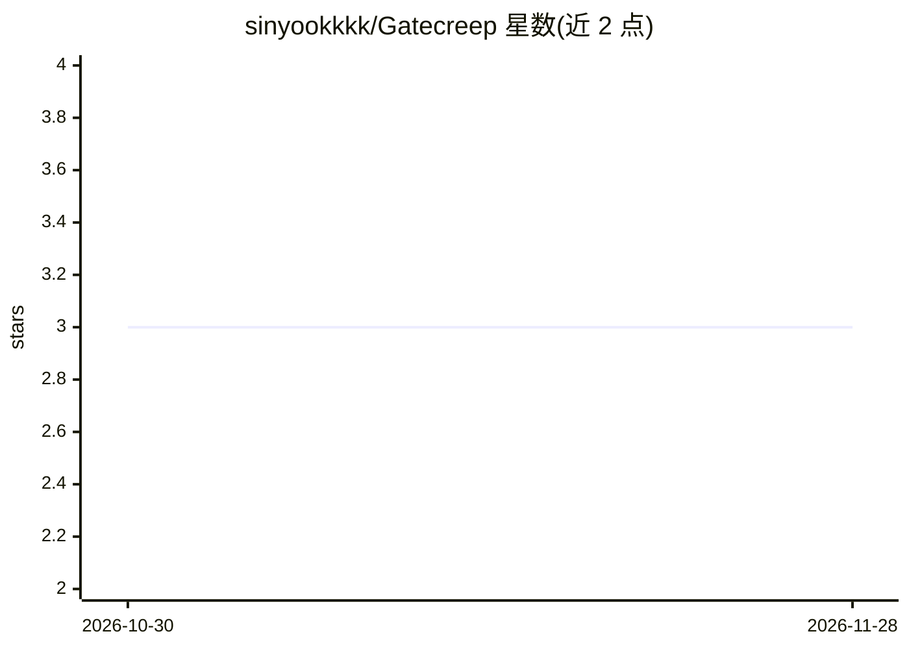

# sinyookkkk/Gatecreep

⭐ 3 · Python · MIT · 推送 2026-10-30 · [GitHub](https://github.com/sinyookkkk/Gatecreep) · 个人维护 · 中文 README

**审计 Python Agent/CLI/Skill 项目的只读门禁检查 Skill**

Gatecreep 是一个由模型执行的审计 Skill，用于检查 Python AI Agent、CLI 和 Skill 项目中阻断合法任务的校验规则、硬编码限制与静默截断。机制上由标准库 Python 脚本提取静态事实（能力、门禁、调用关系），模型结合项目契约分析影响，报告包含源码证据、因果链、反证与覆盖缺口；审计只读目标项目，不执行代码、不自动修改。需要 Python 3.10+ 与能加载 Skill 的 AI 工具，通过 git clone 获取后在对话中指定 SKILL.md 运行。

## 筛选速览

| 维度 | 判定 | 备注 |
|---|---|---|
| AI 角色 | `ai-native` | 本体是模型或模型工具 |
| 许可风险 | `permissive` | MIT |
| 部署形态 | `None` |  |
| 模型依赖 | — | README 未给出锁定关系 |
| 硬件要求 | — | 无带数字的原话,不猜 |
| 安装摩擦 | `low` | 无编译、无系统依赖或容器化 |
| 成熟度 | — | 结构信号不足 |

## 能力要点

- 标准库脚本提取静态事实，模型结合项目契约判断影响
- 报告包含源码证据、因果链、反证与覆盖缺口
- 审计只读，不执行目标代码或自动修改项目
- 四阶段功能发现流程，每步保存 JSON 并关联 evidence.json

## 适用场景

- 排查 AI Agent 中合法输入被校验规则拒绝的问题
- 检查 CLI 工具的硬编码数量限制与批量失败处理
- 审计 MCP 工具声明与门禁的对应关系
- 复核既有审计报告的证据是否充分

## 场景标签

`代码审查` · 领域:编码与开发

## 证据(README 行号)

> L3: **审计 Python Agent、CLI 和 Skill 项目中阻断合法任务的校验、硬编码限制与静默截断。**
> L7: Gatecreep 是由模型执行的审计 Skill：标准库脚本提取静态事实，模型结合项目契约判断影响，报告给出源码证据、因果链、反证与覆盖缺口。

## 星数曲线

2026-10-30 3 → 2026-11-28 3（+0）

---
*卡片 v1 · prompt 1.4 · 生成 2026-11-21 · 置信度 high · 依据 README sha `de4185a54538` · [字段定义](../../DATASET.md)*
