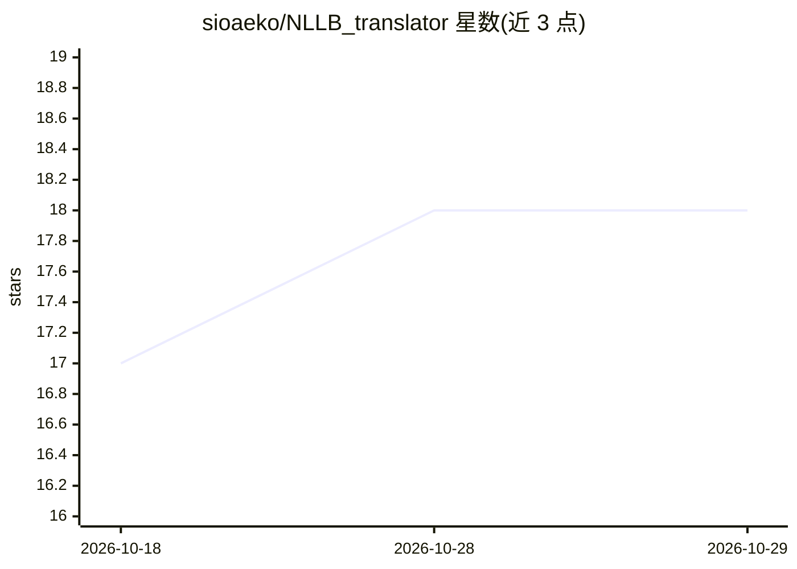

# sioaeko/NLLB_translator

⭐ 18 · Python · MIT · 推送 2026-10-15 · [GitHub](https://github.com/sioaeko/NLLB_translator) · [官网](https://huggingface.co/spaces/Asanari/nllb-translator) · 个人维护

**多引擎翻译 Web 应用：本地/云端模型统一界面译 200 种语言**

面向终端用户的翻译 Web 应用：在单一界面中按请求切换 9 种翻译引擎——服务器本地运行的 NLLB-200（CTranslate2 int8 CPU 推理）、Hy-MT2（GGUF）、以及经 Ollama 托管的 TranslateGemma/Qwen 小模型；云端引擎 Gemini、Groq、OpenRouter、OpenAI 使用用户自有 key。后端为 FastAPI + provider registry 路由，前端 Next.js + Tailwind，支持流式输出、FLORES-200 全 200 语言、缓存与取消。通过 Docker Compose 或 HuggingFace Space 单容器部署；本地模型首次构建需下载约 2.4 GB（NLLB）。

## 筛选速览

| 维度 | 判定 | 备注 |
|---|---|---|
| AI 角色 | `ai-native` | 本体是模型或模型工具 |
| 许可风险 | `permissive` | MIT |
| 部署形态 | `self-host` | docker 或自建部署 |
| 模型依赖 | local-ok | 支持本地模型 |
| 硬件要求 | — | 无带数字的原话,不猜 |
| 安装摩擦 | `low` | 无编译、无系统依赖或容器化 |
| 成熟度 | — | 结构信号不足 |

## 能力要点

- 9 种引擎（5 本地 + 4 云端）按请求切换，统一 UI
- 本地引擎无需第三方 API，NLLB-200 支持 200 语言 int8 CPU 推理
- LLM 翻译 token 级流式输出，支持请求取消与服务端/浏览器两级缓存
- 新增引擎只需实现 TranslationProvider 接口的单文件

## 适用场景

- 在自建服务器上免 API key 翻译 200 种语言
- 在本地与云端模型间对比翻译结果并按需切换
- 通过 REST/NDJSON 流式 API 将多引擎翻译接入其他应用

## 场景标签

 · 领域:机器翻译/Web 应用

## 证据(README 行号)

> L19: Pick the translation **engine per request**: **NLLB-200**, Tencent's **Hy-MT2**, **TranslateGemma 4B**, **Qwen3.5 2
> L27: |**NLLB-200 (600M)**|🖥️ this server|model converted|Meta · 200 languages · int8 CPU inference|

## 星数曲线

2026-10-18 17 → 2026-10-29 18（+1）

---
*卡片 v1 · prompt 1.4 · 生成 2026-10-29 · 置信度 mid · 依据 README sha `a141ef02ebf9` · [字段定义](../../DATASET.md)*
