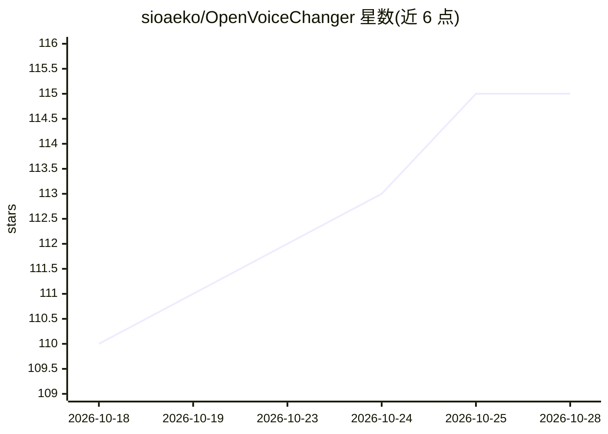

# sioaeko/OpenVoiceChanger

⭐ 116 · Python · MIT · 推送 2026-09-05 · [GitHub](https://github.com/sioaeko/OpenVoiceChanger) · 个人维护

**实时 AI 变声 Web 应用：麦克风经 RVC/ONNX 模型低延迟变声**

基于 React+FastAPI 的实时变声 Web 应用：麦克风音频经 WebSocket 流式送入 ONNX 或 RVC（PyTorch）模型转换，支持音高/共振峰调节、16 种 F0 方法、12 效果 DSP 链、16 个预置音色，另有离线整文件转换器。无模型时可用纯 DSP 模式。提供模型拖拽上传、性能画像推荐、应用内更新（经托管启动器）等管理功能。源码运行，Windows x64 CPU 有一键安装 RVC 依赖与 HuBERT/RMVPE 权重的快捷路径。

## 筛选速览

| 维度 | 判定 | 备注 |
|---|---|---|
| AI 角色 | `ai-native` | 本体是模型或模型工具 |
| 许可风险 | `permissive` | MIT |
| 部署形态 | `desktop` | 安装包/桌面程序 |
| 模型依赖 | — | README 未给出锁定关系 |
| 硬件要求 | — | 无带数字的原话,不猜 |
| 安装摩擦 | `high` | 编译与系统依赖俱全 |
| 成熟度 | — | 结构信号不足 |

## 能力要点

- WebSocket+AudioWorklet 实时流式变声，支持 ONNX 与 RVC（.pth/.pt）模型
- 12 效果服务器端 DSP 链与 16 个预置音色，无模型时纯 DSP 模式可用
- 16 种 F0 方法（PM/Harvest/Crepe/RMVPE/FCPE 等）按运行时可用性显示
- 离线整文件转换与浏览器内录音 Take 库（IndexedDB）

## 适用场景

- 直播或语音聊天中实时改变自己的声音
- 把整段音频文件渲染成变声后的 WAV
- 不加载模型时仅用音高/效果链做 DSP 变声处理

## 场景标签

 · 领域:语音处理/实时音频

## 证据(README 行号)

> L9:  Real-time AI voice changer web application.
> L10:  Route a microphone through ONNX or RVC models with a low-latency WebSocket audio pipeline.
> L22: - Real-time voice conversion with binary WebSocket streaming and AudioWorklet
> L224: |`.pth` / `.pt`|PyTorch|RVC v1/v2 models, requires `hubert_base.pt`|

## 星数曲线

2026-10-18 110 → 2026-10-28 115（+5）

---
*卡片 v1 · prompt 1.4 · 生成 2026-10-23 · 置信度 high · 依据 README sha `e4f84c676917` · [字段定义](../../DATASET.md)*
