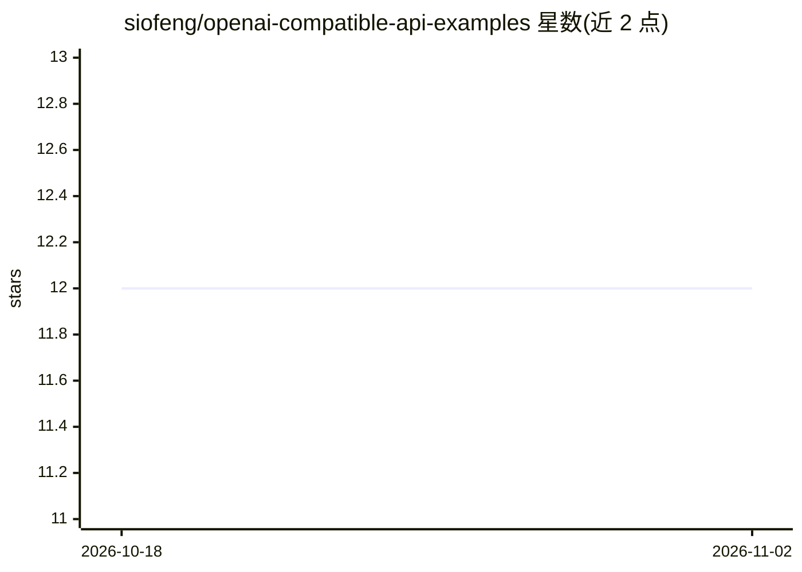

# siofeng/openai-compatible-api-examples

⭐ 12 · Python · MIT · 推送 2026-08-19 · [GitHub](https://github.com/siofeng/openai-compatible-api-examples) · [官网](https://api.luoluocoder.com/docs) · 个人维护

**调用 OpenAI 兼容与 Claude Messages API 的可运行示例集**

提供 Python、Node.js 和 cURL 三种语言的最小可运行示例，覆盖 OpenAI 兼容 chat completions、Claude Messages API 与流式响应。所有示例通过环境变量配置 API key、base URL 和模型 ID，可指向任意兼容供应商而无需修改代码。模板预配置了独立托管 API 网关 luoluoAI 的地址，README 同时说明兼容端点在流式、工具调用、结构化输出等方面的差异需自行测试，并附生产环境检查清单。以 MIT 许可发布。

## 筛选速览

| 维度 | 判定 | 备注 |
|---|---|---|
| AI 角色 | `ai-knowledge` | 知识聚合/清单类 |
| 许可风险 | `permissive` | MIT |
| 部署形态 | `library` | 以包/库形式分发 |
| 模型依赖 | locked-api |  |
| 硬件要求 | — | 无带数字的原话,不猜 |
| 安装摩擦 | `low` | 无编译、无系统依赖或容器化 |
| 成熟度 | — | 结构信号不足 |

## 能力要点

- Python / Node.js / cURL 三种语言的最小可运行示例
- 环境变量驱动配置，可指向任意兼容供应商
- 覆盖 chat completions、Claude Messages API 与流式响应
- 附带生产部署检查清单（密钥管理、超时、限流测试等）

## 适用场景

- 快速上手 OpenAI 兼容或 Claude Messages API 的调用方式
- 在不同兼容供应商之间切换端点而无需改代码
- 部署前核对流式、工具调用等特性差异

## 场景标签

`教程课程` · 领域:学习与行业

## 证据(README 行号)

> L3: Small, runnable examples for calling OpenAI-compatible APIs and the Claude
> L9: ## Included examples

## 星数曲线

2026-10-18 12 → 2026-11-02 12（+0）

---
*卡片 v1 · prompt 1.4 · 生成 2026-11-01 · 置信度 high · 依据 README sha `4eb90692103e` · [字段定义](../../DATASET.md)*
