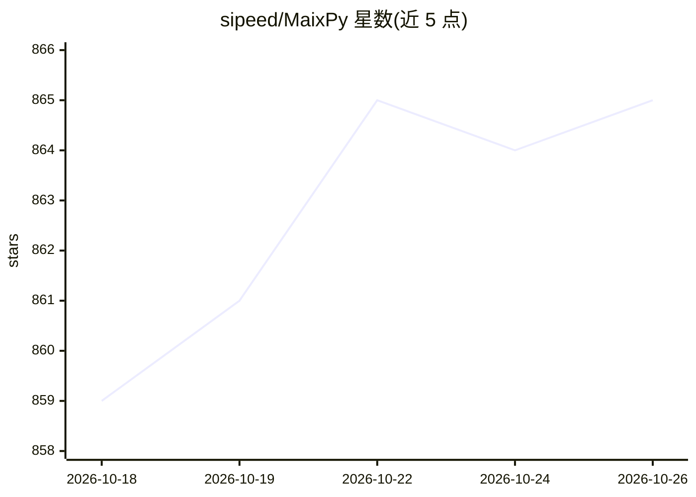

# sipeed/MaixPy

⭐ 865 · Python · NOASSERTION · 推送 2026-10-15 · [GitHub](https://github.com/sipeed/MaixPy) · [官网](https://wiki.sipeed.com/maixpy/) · 组织维护 · 中文 README

**边缘设备上用 Python 开发 AI 视觉项目的 SDK，配 MaixCAM 硬件**

Sipeed 维护的边缘 AI Python SDK（v4），运行于 MaixCAM / MaixCAM2 / MaixCAM-Pro 硬件平台：提供摄像头、串口等外设操作、AI 视觉算法（分类/检测，MobileNet、YOLO 系列）、音频算法、二维码识别及 MaixCAM2 上的 LLM/VLM 运行能力；配套 MaixVision 桌面开发工具、MaixHub 在线训练平台与同 API 的 C/C++ SDK。面向 AI 算法工程师、STEM 教师、创客、学生与企业用户，可从源码编译固件，仓库采用 Apache 2.0 许可。

## 筛选速览

| 维度 | 判定 | 备注 |
|---|---|---|
| AI 角色 | `ai-native` | 本体是模型或模型工具 |
| 许可风险 | `none` | NOASSERTION |
| 部署形态 | `library` | 以包/库形式分发 |
| 模型依赖 | — | README 未给出锁定关系 |
| 硬件要求 | — | 无带数字的原话,不猜 |
| 安装摩擦 | `low` | 无编译、无系统依赖或容器化 |
| 成熟度 | — | 结构信号不足 |

## 能力要点

- 10 行 Python 代码实现 AI 视觉分类/检测，NPU 加速
- MaixCAM2 支持 Qwen/DeepSeek 0.5B-1.5B LLM 与 InternVL 1B VLM 端侧运行
- 配套 MaixVision IDE、MaixHub 在线训练平台与同 API 的 C/C++ SDK
- README 提供三款硬件平台的算力/内存/帧率对比表

## 适用场景

- 把训练好的视觉模型部署到嵌入式设备做实时检测
- 教学场景中讲授 AI 与嵌入式开发
- 企业快速搭建产线质检或安防监控等 AI 视觉原型

## 场景标签

`目标检测` · 领域:感知与多模态

## 证据(README 行号)

> L28: MaixPy offers simple Python programming combined with powerful edge computing hardware. Integrated hardware periphe
> L43: classifier = nn.Classifier(model="/root/models/mobilenetv2.mud")
> L113: |LLM|❌|❌|Qwen/DeepSeek 0.5B(fftf: 640ms, 9 tokens/s) Qwen/DeepSeek 1.5B(fftf: 1610ms, 4 tokens/s) VLM(InterVL 1B) 

## 星数曲线

2026-10-18 859 → 2026-10-26 865（+6）

---
*卡片 v1 · prompt 1.4 · 生成 2026-10-21 · 置信度 mid · 依据 README sha `fb2e78ec6549` · [字段定义](../../DATASET.md)*
