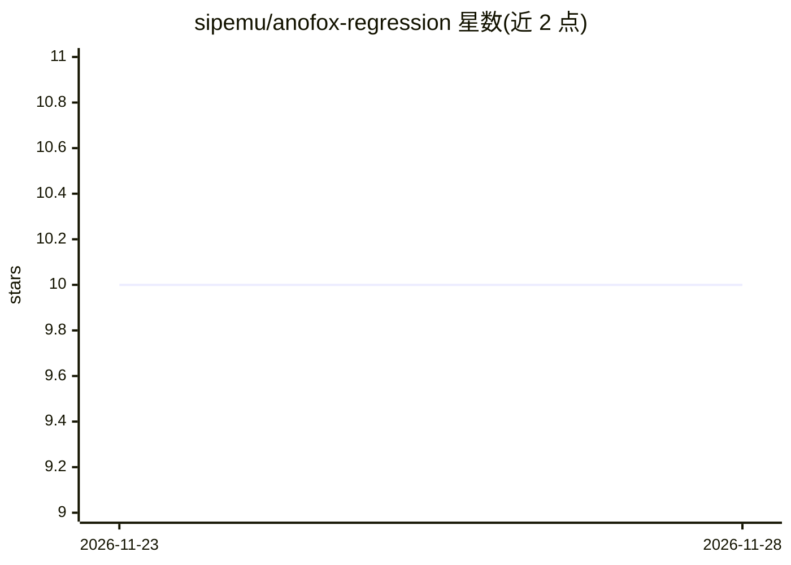

# sipemu/anofox-regression

⭐ 10 · Rust · MIT · 推送 2026-11-06 · [GitHub](https://github.com/sipemu/anofox-regression) · 个人维护

**Rust 回归分析统计库：带完整统计推断的 sklearn 风格估计器**

面向 Rust 开发者的回归分析库，提供 sklearn 风格 API 与完整统计推断（标准误、t 统计量、p 值、置信/预测区间）。覆盖 OLS/WLS、Ridge、Elastic Net、Huber、GLM 家族（Logistic/Poisson/Negative Binomial/Tweedie）、GLMM、生存分析（Kaplan-Meier、Cox）、分位数与稳健回归等。开发中通过 TDD 对照 R 与 scikit-learn 1.9.1 验证，745 项参考比较在文档化容差内一致，验证脚本与容差依据记录在 validation/VALIDATION.md。通过 Cargo.toml 引入，最低 Rust 1.87。

## 筛选速览

| 维度 | 判定 | 备注 |
|---|---|---|
| AI 角色 | `ai-native` | 本体是模型或模型工具 |
| 许可风险 | `permissive` | MIT |
| 部署形态 | `library` | 以包/库形式分发 |
| 模型依赖 | — | README 未给出锁定关系 |
| 硬件要求 | — | 无带数字的原话,不猜 |
| 安装摩擦 | `low` | 无编译、无系统依赖或容器化 |
| 成熟度 | — | 结构信号不足 |

## 能力要点

- 线性/广义线性/混合模型/生存分析等多类回归估计器
- 完整统计推断输出：标准误、p 值、置信区间、预测区间
- 745 项参考比较对照 R 与 scikit-learn 验证数值一致性
- SufficientStats 支持增量与分布式拟合

## 适用场景

- 在 Rust 项目中做带 p 值与置信区间的回归建模
- 对计数/生存/有序等特殊因变量拟合统计模型
- 需要与 R 或 scikit-learn 结果可对照验证的统计计算

## 场景标签

 · 领域:数据科学/统计计算

## 证据(README 行号)

> L14: A robust statistics library for regression analysis in Rust, validated against R and scikit-learn (VALIDATION).
> L16: This library provides sklearn-style regression estimators with full statistical inference support including standar

## 星数曲线

2026-11-23 10 → 2026-11-28 10（+0）

---
*卡片 v1 · prompt 1.4 · 生成 2026-11-23 · 置信度 high · 依据 README sha `7bbfe1698a60` · [字段定义](../../DATASET.md)*
