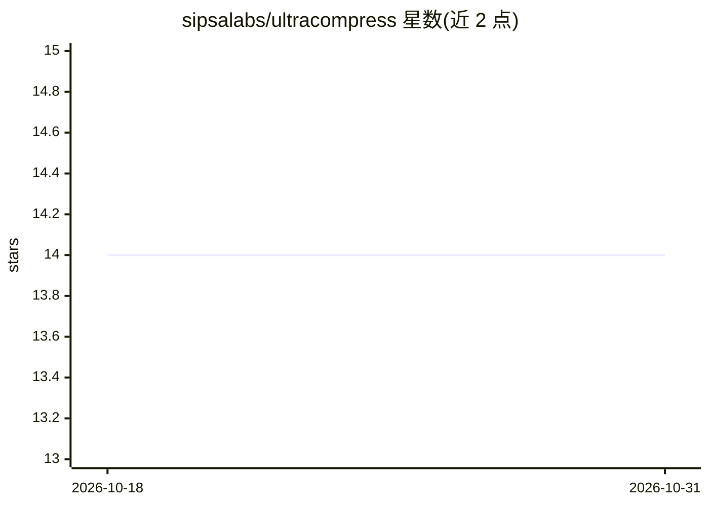

# sipsalabs/ultracompress

⭐ 14 · Python · NOASSERTION · 推送 2026-09-30 · [GitHub](https://github.com/sipsalabs/ultracompress) · [官网](https://sipsalabs.com) · 组织维护

**已停用的 5-bit 模型压缩研究存档：CLI 校验压缩包结构并算 SHA-256 指纹**

Sipsa Labs 保留的历史研究仓库：记录将 fp16/bf16 transformer 压缩为 5-bit pack 的方法与 22+1 个架构的 PPL 验证结果（含 405B 模型在单张 32GB 消费级 GPU 上压缩的记录），并声明 pack 可确定性解码到 SHA-256 固定的校验产物。项目已 retired，不再提供 API 与付费试点；公开 CLI 仅做 pack 结构检查与指纹计算，不重建权重、不做在线推理。编解码器细节专利待批，源码为 BUSL-1.1 附加使用授权（4 年后转 Apache 2.0）。

## 筛选速览

| 维度 | 判定 | 备注 |
|---|---|---|
| AI 角色 | `ai-ecosystem` | LLM/agent 周边工具 |
| 许可风险 | `none` | NOASSERTION |
| 部署形态 | `library` | 以包/库形式分发 |
| 模型依赖 | — | README 未给出锁定关系 |
| 硬件要求 | — | 无带数字的原话,不猜 |
| 安装摩擦 | `medium` | 含编译或系统依赖之一 |
| 成熟度 | — | 结构信号不足 |

## 能力要点

- uc verify 检查 pack 结构并计算 SHA-256 指纹（可 --skip-hash / --full）
- 记录 22 个 PPL 端到端验证架构（0.6B–405B，dense/MoE/SSM）+ 1 个 ViT
- 公开'尚未工作'清单与负面实验结果（含 13.7x 回归等）
- Hermes-3-Llama-3.1-405B 在单张 32GB 消费级 GPU 上完成 5bpw 压缩（1.0066x PPL 比）

## 适用场景

- 下载历史压缩 pack 后本地核对其结构与 SHA-256 指纹
- 查阅 5-bit 近无损压缩在各架构上的历史 PPL 验证数据
- 了解面向合规审计的可验证重建契约的实验记录

## 场景标签

`模型量化` · 领域:训练与推理

## 证据(README 行号)

> L16: UltraCompress takes a transformer at fp16/bf16 and produces a 5-bit pack with **reproducible, cryptographically ver
> L49: `uc verify` checks a readable manifest, layer-file presence, the declared layer count when supplied as an integer, 

## 星数曲线

2026-10-18 14 → 2026-10-31 14（+0）

---
*卡片 v1 · prompt 1.4 · 生成 2026-10-31 · 置信度 high · 依据 README sha `fb92dbfb7acf` · [字段定义](../../DATASET.md)*
