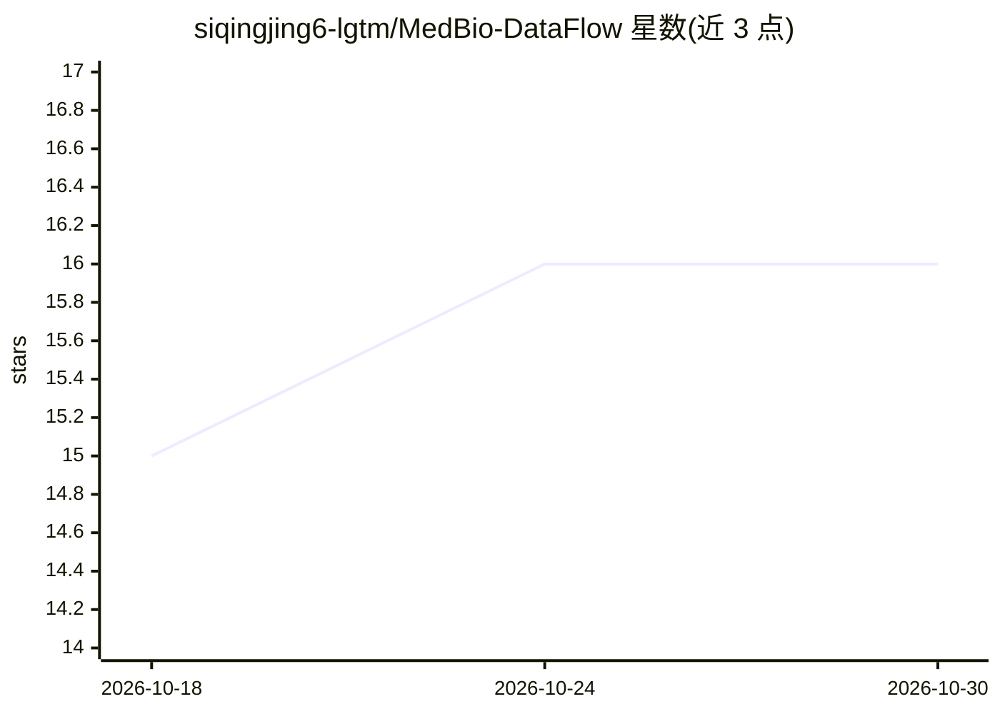

# siqingjing6-lgtm/MedBio-DataFlow

⭐ 16 · Python · MIT · 推送 2026-07-25 · [GitHub](https://github.com/siqingjing6-lgtm/MedBio-DataFlow) · 个人维护

**临床数据统计与多组学样本准备 Python 工具包**

面向临床医学研究者与生物信息学人员的轻量 Python 工具包：提供带交叉验证的 LASSO 回归生物标志物特征筛选流水线、一键多变量 logistic 回归建模并自动计算 Odds Ratio、用于 bulk RNA 测序等组织采样指标（厚度、表面积）的质控算法，以及多组学样本准备流程。结构模块化，可集成到 LLM 驱动的科研 agent 工作流。通过 git clone 源码加 pip 依赖安装，附带演示数据集与自动化脚本。

## 筛选速览

| 维度 | 判定 | 备注 |
|---|---|---|
| AI 角色 | `ai-native` | 本体是模型或模型工具 |
| 许可风险 | `permissive` | MIT |
| 部署形态 | `library` | 以包/库形式分发 |
| 模型依赖 | — | README 未给出锁定关系 |
| 硬件要求 | — | 无带数字的原话,不猜 |
| 安装摩擦 | `low` | 无编译、无系统依赖或容器化 |
| 成熟度 | — | 结构信号不足 |

## 能力要点

- LASSO 回归（含交叉验证）特征筛选流水线
- 多变量 logistic 回归自动建模与 OR 计算
- 组织采样指标质控（厚度/表面积等）
- 提供开箱即用的演示数据集与脚本

## 适用场景

- 临床生物标志物筛选时跑 LASSO 特征选择
- 批量做 logistic 回归并自动输出 Odds Ratio
- bulk RNA 测序样本的采样指标质控

## 场景标签

`科研工具` · 领域:学习与行业

## 证据(README 行号)

> L11: * **Automated Feature Screening**: Integrated LASSO regression pipelines with cross-validation for clinical biomark
> L12: * **Streamlined Clinical Modeling**: Instant multivariable logistic regression modeling with automatic Odds Ratio (

## 星数曲线

2026-10-18 15 → 2026-10-30 16（+1）

---
*卡片 v1 · prompt 1.4 · 生成 2026-10-30 · 置信度 low · 依据 README sha `559eb92caa99` · [字段定义](../../DATASET.md)*
