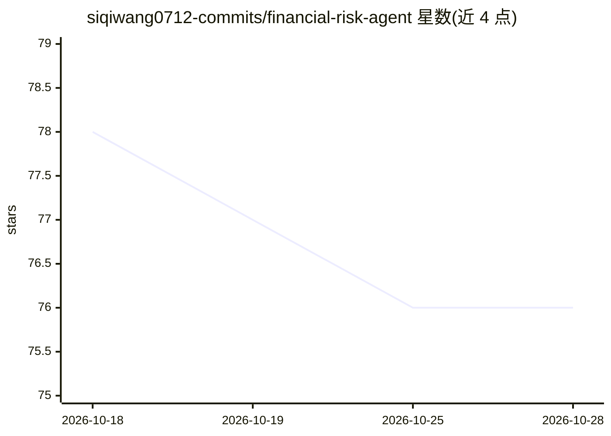

# siqiwang0712-commits/financial-risk-agent

⭐ 76 · Python · Apache-2.0 · 推送 2026-10-20 · [GitHub](https://github.com/siqiwang0712-commits/financial-risk-agent) · [官网](https://financial-risk-agent.vercel.app) · 个人维护 · 中文 README

**面向企业财报的证据溯源金融风险分析与决策保证研究系统**

FinRisk 是从 SEC/XBRL 结构化数据与年报 PDF 中生成金融风险评估的研究原型系统：确定性指标与传统筛选模型（Altman Z、Beneish M 等）计算信号，Schema 约束的 LLM 仅解释叙述性披露；68 条版本化规则与 Agent 推理可提出决策建议，但最终决策由独立的 Assurance Runtime 基于证据充分性、脆弱性与校准状态授权，并输出可重放、哈希绑定的决策证书。0–100 风险指数为未校准启发式，声明无外部验证或生产级保证。后端 FastAPI、前端 Next.js，提供 Docker Compose 与本地开发两条路径。

## 筛选速览

| 维度 | 判定 | 备注 |
|---|---|---|
| AI 角色 | `ai-native` | 本体是模型或模型工具 |
| 许可风险 | `permissive` | Apache-2.0 |
| 部署形态 | `self-host` | docker 或自建部署 |
| 模型依赖 | — | README 未给出锁定关系 |
| 硬件要求 | — | 无带数字的原话,不猜 |
| 安装摩擦 | `low` | 无编译、无系统依赖或容器化 |
| 成熟度 | `idea` | |

## 能力要点

- XBRL 摄取与确定性归一化，保留申报期、单位、重述等溯源信息
- LLM 仅承担受约束的叙述解读，比率与模型公式由确定性工具计算
- 预测层只能提出建议，最终决策由 fail-closed 的 Assurance Runtime 授权
- 不可变决策证书：输入摘要、组件版本与保证状态内容哈希、可重放

## 适用场景

- 分析 10-K/20-F 等申报文件并追踪每条风险判断到原文出处
- 在发出金融风险评估前检查证据是否充分支持该结论
- 复现研究实验与运行合成数据离线演示

## 场景标签

`金融量化` `科研工具` · 领域:学习与行业

## 证据(README 行号)

> L38: FinRisk is an evidence-grounded financial-risk analysis and decision-assurance research
> L41: structured SEC/XBRL facts and annual-report PDFs with deterministic financial metrics,
> L42: traditional screening models, versioned expert rules, and a constrained LLM that

## 星数曲线

2026-10-18 78 → 2026-10-28 76（-2）

---
*卡片 v1 · prompt 1.4 · 生成 2026-10-24 · 置信度 high · 依据 README sha `fcb38b8f416b` · [字段定义](../../DATASET.md)*
