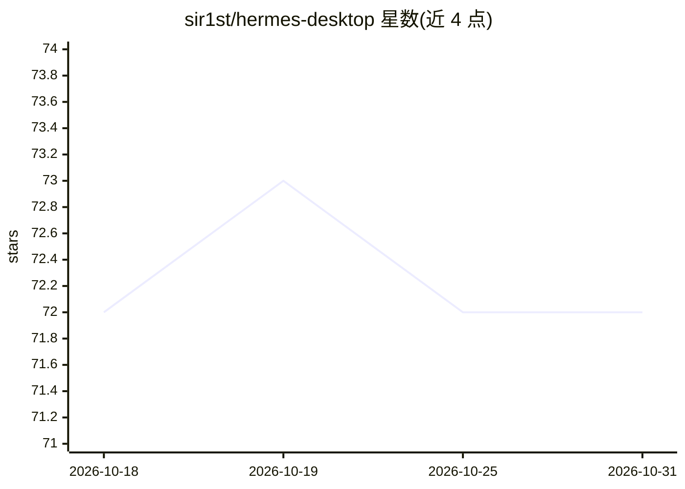

# sir1st/hermes-desktop

⭐ 72 · JavaScript · 推送 2026-06-01 · [GitHub](https://github.com/sir1st/hermes-desktop) · [官网](https://github.com/EKKOLearnAI/hermes-web-ui) · 个人维护 · 中文 README

**Hermes Agent 的跨平台一体化桌面打包应用**

Electron 打包壳：将独立 Python 运行时、hermes-agent（Nous Research 的自改进 AI agent，从 PyPI 原样捆绑）与 hermes-web-ui（Vue 3 + Koa 多平台聊天面板，以 git 子模块内嵌）合并为单一安装包，用户无需自装 Python 或 Node。运行时由 Electron 主进程拉起本地 Koa 服务器并经捆绑 Python 的 hermes CLI 网关对话。提供 macOS/Windows/Linux 安装包；v0.x 未代码签名，需手动绕过 Gatekeeper/SmartScreen。仓库描述声明已迁移至 EKKOLearnAI/hermes-web-ui，本仓库仅保留历史发布。

## 筛选速览

| 维度 | 判定 | 备注 |
|---|---|---|
| AI 角色 | `ai-native` | 本体是模型或模型工具 |
| 许可风险 | `none` | — |
| 部署形态 | `desktop` | 安装包/桌面程序 |
| 模型依赖 | — | README 未给出锁定关系 |
| 硬件要求 | — | 无带数字的原话,不猜 |
| 安装摩擦 | `low` | 无编译、无系统依赖或容器化 |
| 成熟度 | `idea` | |

## 能力要点

- 捆绑 Python 运行时 + hermes-agent 0.14.0 + hermes-web-ui 为单一安装包
- Electron 内运行 vendored Koa 服务器（127.0.0.1:8648）经 preload 注入认证 token
- macOS 双架构 / Windows x64 / Linux x64+arm64 安装包，CI 出 tag 即构建发布
- electron-updater 启动时自动检测更新

## 适用场景

- 在桌面上一键运行 Hermes Agent 而不配置 Python/Node 环境
- 通过多平台聊天面板与 agent 对话
- 对接钉钉等渠道使用 DeepSeek 对话（见演示视频）

## 场景标签

`聊天机器人` · 领域:对话与助手

## 证据(README 行号)

> L5: All-in-one cross-platform desktop app for Hermes Agent.
> L20: - **Hermes Agent** by
> L22:  agent that powers every conversation, tool call, skill, and gateway

## 星数曲线

2026-10-18 72 → 2026-10-31 72（+0）

---
*卡片 v1 · prompt 1.4 · 生成 2026-10-24 · 置信度 mid · 依据 README sha `0bcdfa083a17` · [字段定义](../../DATASET.md)*
