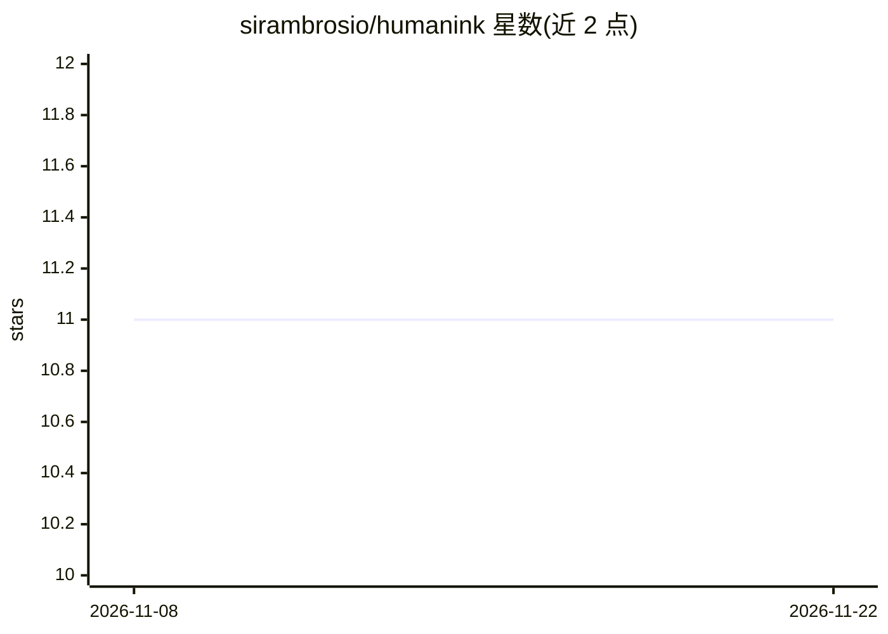

# sirambrosio/humanink

⭐ 11 · MIT · 推送 2026-03-23 · [GitHub](https://github.com/sirambrosio/humanink) · 个人维护

**给写作者的 Claude Code 技能：检测并改写 AI 痕迹文本**

以纯 Markdown 形式分发的 Claude Code / Claude.ai 技能，不含代码与依赖。它按 35 条写作模式清单检测文本中的 AI 痕迹，输出 0-100 的 AI 概率分数、逐段评分与模式报告，并按 5 种语境模式、3 档改写强度执行改写；支持 --diff 查看变更、--explain 注释、跳过区域、个人写作风格指纹（--style），以及 7 种语言的模式检测与本地化映射。安装方式为 git clone 到 ~/.claude/skills 目录，或上传文件至 Claude.ai Project Knowledge。

## 筛选速览

| 维度 | 判定 | 备注 |
|---|---|---|
| AI 角色 | `ai-native` | 本体是模型或模型工具 |
| 许可风险 | `permissive` | MIT |
| 部署形态 | `None` |  |
| 模型依赖 | locked-api |  |
| 硬件要求 | — | 无带数字的原话,不猜 |
| 安装摩擦 | `low` | 无编译、无系统依赖或容器化 |
| 成熟度 | — | 结构信号不足 |

## 能力要点

- 35 条 AI 写作模式清单，含检测触发词、严重度权重与跨语言等价映射
- 0-100 AI 概率评分与逐段评分，区分混合作者文档
- 风格指纹：以用户自己的写作样本分析句长、词汇、标点习惯并据此改写
- 5 种语境模式 × 3 档改写强度，附改写护栏以保留事实与意图

## 适用场景

- 改写 AI 辅助生成的稿件，使其读起来像人写的
- 检测提交文档中哪些段落可能是 AI 生成
- 以自己的写作样本为模板统一个人文风

## 场景标签

`AI 写作` · 领域:内容生成

## 证据(README 行号)

> L7: > Detects 35 AI writing patterns, scores AI probability 0-100, identifies ChatGPT / Claude / Gemini signatures, and 
> L43: Built on research from Wikipedia's "Signs of AI writing" and extended with 11 additional patterns from community ob
> L81: mkdir -p ~/.claude/skills && git clone https://github.com/sirambrosio/humanink.git ~/.claude/skills/humanink

## 星数曲线

2026-11-08 11 → 2026-11-22 11（+0）

---
*卡片 v1 · prompt 1.4 · 生成 2026-11-18 · 置信度 high · 依据 README sha `574854f1a772` · [字段定义](../../DATASET.md)*
