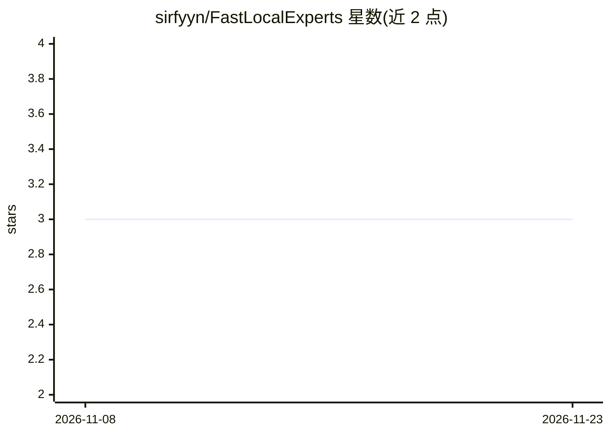

# sirfyyn/FastLocalExperts

⭐ 3 · C++ · MIT · 推送 2026-11-16 · [GitHub](https://github.com/sirfyyn/FastLocalExperts) · [官网](https://sirfyyn.de/en/fle/) · 个人维护

**在单张 32GB GPU 上本地运行大型 MoE 模型的 llama.cpp 分支**

FLE 是一个面向本地 LLM 推理的 llama.cpp 分支，针对大参数量 MoE GGUF 模型：注意力、共享权重、KV 缓存与热点专家缓存驻留 GPU，其余路由专家留在系统内存由 CPU 计算，并用模型自带的 multi-token-prediction 头做投机解码。全部特性为可选开关，未设置时行为等同上游 llama.cpp。构建方式同 llama.cpp（cmake+CUDA），另提供 FLE Link 一键安装脚本，模型文件为标准 GGUF，也可被上游 llama.cpp 读取。README 明确其仅在单台参考机上构建和测量，prefill 速度慢于上游。

## 筛选速览

| 维度 | 判定 | 备注 |
|---|---|---|
| AI 角色 | `ai-ecosystem` | LLM/agent 周边工具 |
| 许可风险 | `permissive` | MIT |
| 部署形态 | `None` |  |
| 模型依赖 | — | README 未给出锁定关系 |
| 硬件要求 | — | 无带数字的原话,不猜 |
| 安装摩擦 | `high` | 编译与系统依赖俱全 |
| 成熟度 | — | 结构信号不足 |

## 能力要点

- GPU 热点专家缓存 + CPU 计算未命中专家的混合推理
- 模型自带 MTP 头的投机解码（每步起草两个 token）
- FLE Link 单文件安装器，检查模型适配后提供 OpenAI 兼容 API
- 所有速度声明附成对测量区间与失败记录（技术报告）

## 适用场景

- 在单张 32GB 显卡的本地工作站上运行 763B 级 MoE 模型
- 通过 OpenAI 兼容 API 在本地接入模型服务
- 按技术报告在相似硬件上复现测量结果

## 场景标签

`推理引擎` · 领域:训练与推理

## 证据(README 行号)

> L11: A llama.cpp fork for running large MoE GGUF models locally (local LLM
> L12: inference) that keeps the hot experts of a large MoE model in a GPU
> L159: The server then listens on <http://127.0.0.1:8080> with llama.cpp's web UI and its OpenAI-compatible API
> L101: All FLE features are opt-in. With none of them set, FLE behaves like the llama.cpp it is based on. Every variable 

## 星数曲线

2026-11-08 3 → 2026-11-23 3（+0）

---
*卡片 v1 · prompt 1.4 · 生成 2026-11-21 · 置信度 high · 依据 README sha `359291cae0e1` · [字段定义](../../DATASET.md)*
