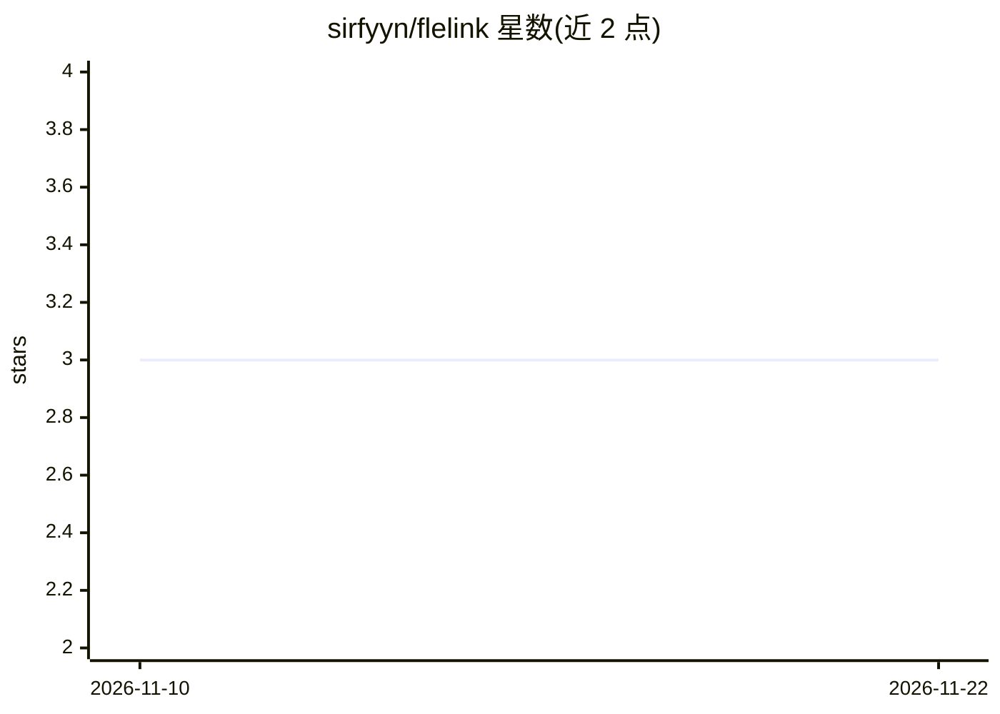

# sirfyyn/flelink

⭐ 3 · Rust · MIT · 推送 2026-11-16 · [GitHub](https://github.com/sirfyyn/flelink) · [官网](https://flelink.run) · 个人维护

**一条命令在本地运行大模型的推理服务与桌面工具**

读取机器配置后自动安装适配的推理引擎、下载匹配模型并启动服务，输出 OpenAI 与 Anthropic 兼容 API、浏览器 Studio 和桌面应用。底层引擎可替换：自研 FLE 引擎用于小 GPU 上的 MoE 模型，回退到上游 llama.cpp 或任意 llama-server 兼容构建。下载前校验模型是否装得下，支持 SHA-256 校验、断点续传，并复用 LM Studio、Ollama 等已有模型文件。

## 筛选速览

| 维度 | 判定 | 备注 |
|---|---|---|
| AI 角色 | `ai-ecosystem` | LLM/agent 周边工具 |
| 许可风险 | `permissive` | MIT |
| 部署形态 | `desktop` | 安装包/桌面程序 |
| 模型依赖 | local-ok | 支持本地模型 |
| 硬件要求 | — | 无带数字的原话,不猜 |
| 安装摩擦 | `low` | 无编译、无系统依赖或容器化 |
| 成熟度 | — | 结构信号不足 |

## 能力要点

- 读取机器配置，下载前校验模型与硬件匹配，支持断点续传
- OpenAI 与 Anthropic 兼容 API 同址提供，可接入 Claude Code、Codex 等编码工具
- 引擎可替换：FLE、llama.cpp 或自定义 llama-server 构建
- 提供 MCP server，编码代理可下载、加载、停止模型并读取日志

## 适用场景

- 在单张 32 GB GPU 上以量化方式运行 763B MoE 大模型
- 为本地编码代理提供 OpenAI/Anthropic 兼容的推理端点
- 通过基准任务对比不同机器与运行时的实际输出速度

## 场景标签

`推理引擎` · 领域:训练与推理

## 证据(README 行号)

> L15: FLE Link reads your machine, installs the engine that fits, downloads a model that fits, picks the start settings a
> L16: OpenAI- and Anthropic-compatible API, a browser Studio and a desktop app. The engine underneath can be swapped:
> L17: FLE (Fast Local Experts) for big mixture-of-experts models on small GPUs, the

## 星数曲线

2026-11-10 3 → 2026-11-22 3（+0）

---
*卡片 v1 · prompt 1.4 · 生成 2026-11-21 · 置信度 high · 依据 README sha `7ae1bef65ab0` · [字段定义](../../DATASET.md)*
