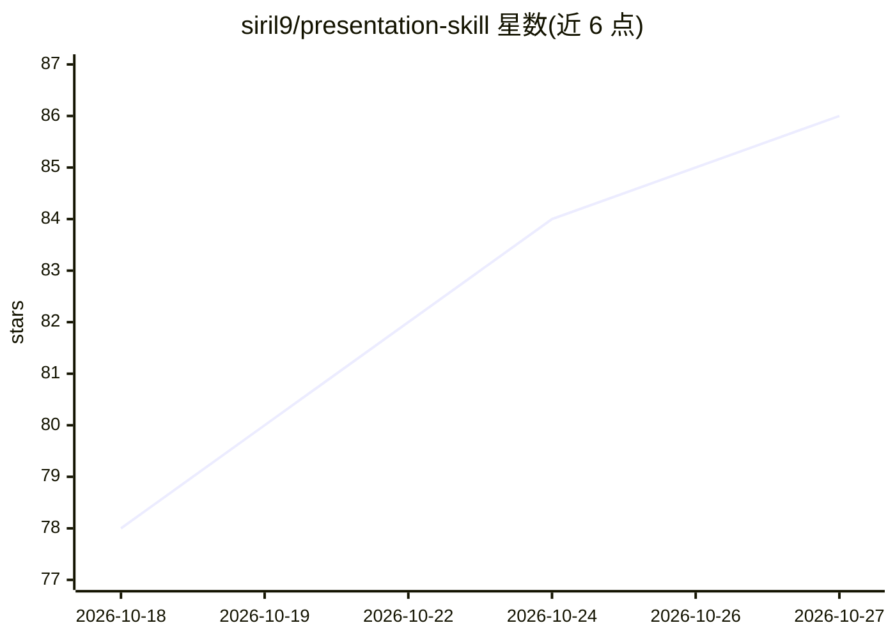

# siril9/presentation-skill

⭐ 86 · Python · MIT · 推送 2026-10-08 · [GitHub](https://github.com/siril9/presentation-skill) · [官网](https://github.com/siril9/presentation-skill#readme) · 个人维护

**给编码 agent 的 PowerPoint 技能：从 JSON 源生成可编辑幻灯片并做版式 QA**

面向编码 agent（Codex 插件或通用 SKILL.md）的演示文稿技能：以 outline.json 为源码，用 pptxgenjs 渲染器（16 种内容变体）构建可编辑 .pptx，配 13 套风格预设与 8 种全稿组合语法；交付前运行几何、渲染图像、占位符与设计规则的分层 QA 闭环，可用哈希绑定的评审回执防止复用过期审批。支持快速一稿与可版本化工作区模式（deck_ir.json），也可对独立 .pptx 做保留式参考编辑。需本地 Python 与 Node 环境，渲染核验依赖 LibreOffice/Poppler（可选）。

## 筛选速览

| 维度 | 判定 | 备注 |
|---|---|---|
| AI 角色 | `ai-ecosystem` | LLM/agent 周边工具 |
| 许可风险 | `permissive` | MIT |
| 部署形态 | `library` | 以包/库形式分发 |
| 模型依赖 | — | README 未给出锁定关系 |
| 硬件要求 | — | 无带数字的原话,不猜 |
| 安装摩擦 | `low` | 无编译、无系统依赖或容器化 |
| 成熟度 | — | 结构信号不足 |

## 能力要点

- outline.json 为源、pptxgenjs 渲染的可编辑 .pptx 构建流程
- 16 种内容变体、13 套风格预设、8 种全稿组合语法
- 分层 QA 闭环：几何/渲染检查/占位符/设计规则，支持哈希绑定评审回执
- 工作区模式带版本化 Deck IR 与就绪诊断

## 适用场景

- 让 agent 从单条提示生成一次性 5-10 页可编辑幻灯片
- 从结构化 outline.json 构建可迭代、可审计的演示工作区
- 生成实验报告、董事会备忘、投资者更新、临床仪表盘等风格一致的成套幻灯片
- 对生成的幻灯片做版式与设计 QA 核验

## 场景标签

 · 领域:开发工具/文档生成

## 证据(README 行号)

> L3: A skill for coding agents that produces editable PowerPoint decks from structured source files. The idea is to treat
> L69: Install the skill for any supported coding agent:
> L115: Other coding agents can use the same `SKILL.md` through the skills.sh installer. The skill needs a local environme

## 星数曲线

2026-10-18 78 → 2026-10-27 86（+8）

---
*卡片 v1 · prompt 1.4 · 生成 2026-10-24 · 置信度 high · 依据 README sha `dfd82737bdb7` · [字段定义](../../DATASET.md)*
