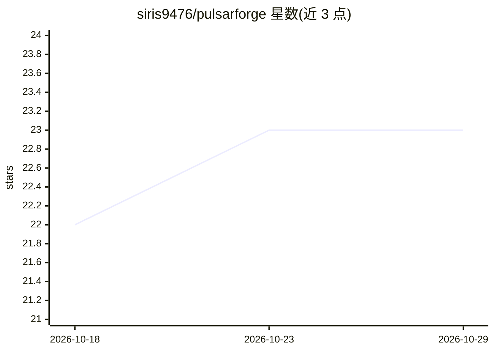

# siris9476/pulsarforge

⭐ 23 · C · NOASSERTION · 推送 2026-09-10 · [GitHub](https://github.com/siris9476/pulsarforge) · 个人维护

**CPU-only LLM 推理引擎：在 32GB 内存笔记本上流式运行 744B MoE 模型**

用 C11 从零编写的纯 CPU LLM 推理引擎（研究性质），支持 qwen3、qwen3moe、deepseek2 (MLA)、olmoe、glm-dsa 五种架构，均对照独立 oracle 做位级或 argmax 级验证。核心机制是把 202GB 的 GGUF/自有 .forge 容器放在 USB SSD 上，按 token 经 LRU 缓存与跨层预测预取（80.8% 召回）流式读取专家权重，配合到达序计算/IO 重叠，在 2018 款 i7/32GB 笔记本上以约 9 s/token 运行 GLM-5.2 744B；后续引入 Huffman 压缩 .forgezh 容器与 cache-aware router 后约 4.5 s/token。Windows 为主目标、Linux 验证位级一致；需自行编译，模型转换一次约耗时一天。附带公开的工程回顾文档记录全部测量与失败实验。

## 筛选速览

| 维度 | 判定 | 备注 |
|---|---|---|
| AI 角色 | `ai-ecosystem` | LLM/agent 周边工具 |
| 许可风险 | `none` | NOASSERTION |
| 部署形态 | `desktop` | 安装包/桌面程序 |
| 模型依赖 | — | README 未给出锁定关系 |
| 硬件要求 | `cpu-ok` | |
| 安装摩擦 | `high` | 编译与系统依赖俱全 |
| 成熟度 | `idea` | |

## 能力要点

- 五种架构经独立 oracle 位级/argmax 级验证
- 专家权重从 USB SSD 按 token 流式读取，LRU 缓存+跨层预测预取+计算/IO 重叠
- 自有 .forge/.forgezh 容器格式：流式可断点转换、位预算按测量分配
- Windows/Linux 同源跨平台位级一致输出

## 适用场景

- 在无 GPU、32GB 内存的笔记本上运行 700B 级 MoE 模型
- 研究极端低硬件门槛下的专家流式推理技术
- 对照测量数据学习 CPU 推理引擎的实现与调优

## 场景标签

`推理引擎` · 领域:训练与推理

## 证据(README 行号)

> L3: A from-scratch, **CPU-only LLM inference engine in C11** that pushes a
> L30: - **Expert streaming on pure CPU**: the 202GB GGUF lives on a USB SSD;
> L151: |**PulsarForge**|**C, CPU-only**|**GLM-5.2 744B @ ~0.22 tok/s**|**32GB RAM, 580-590MB/s USB SSD (real), zero GPU**

## 星数曲线

2026-10-18 22 → 2026-10-29 23（+1）

---
*卡片 v1 · prompt 1.4 · 生成 2026-10-27 · 置信度 high · 依据 README sha `663ab07855c7` · [字段定义](../../DATASET.md)*
