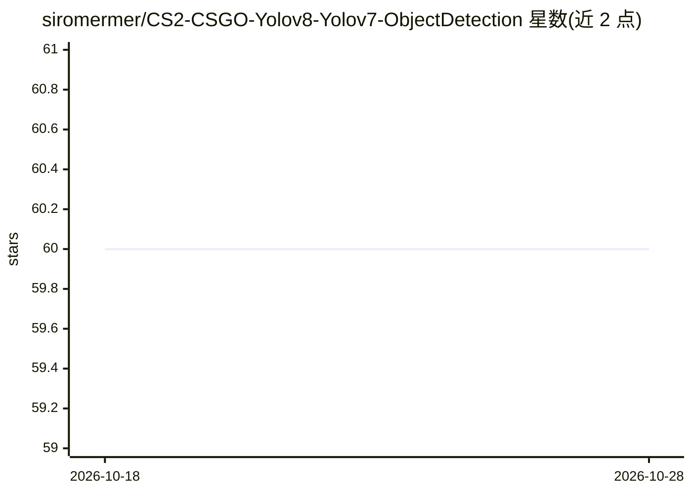

# siromermer/CS2-CSGO-Yolov8-Yolov7-ObjectDetection

⭐ 60 · Jupyter Notebook · 推送 2026-02-19 · [GitHub](https://github.com/siromermer/CS2-CSGO-Yolov8-Yolov7-ObjectDetection) · 个人维护

**CSGO 游戏内实时目标检测与自动瞄准的 YOLOv8 扩展**

针对 Counter-Strike: Global Offensive 的实时目标检测系统：使用自采游戏截图数据集训练的 YOLOv8 nano 模型检测画面中的目标，并通过自动鼠标控制锁定目标。提供 PyTorch 标准版与 TensorRT 加速版两套运行方式，TensorRT engine 文件需在本地按 GPU 硬件导出。仓库还包含训练 notebook、配置文件、评估结果与测试图片。声明仅限教育与研究用途，仅支持已停止在线游玩的 CSGO；CS2 因缺少 Raw input 与鼠标加速选项暂不适用。

## 筛选速览

| 维度 | 判定 | 备注 |
|---|---|---|
| AI 角色 | `ai-native` | 本体是模型或模型工具 |
| 许可风险 | `none` | — |
| 部署形态 | `library` | 以包/库形式分发 |
| 模型依赖 | — | README 未给出锁定关系 |
| 硬件要求 | — | 无带数字的原话,不猜 |
| 安装摩擦 | `medium` | 含编译或系统依赖之一 |
| 成熟度 | — | 结构信号不足 |

## 能力要点

- YOLOv8 nano 模型实时检测并自动控制鼠标锁定目标
- 提供 PyTorch 与 TensorRT 两种推理版本，engine 文件需按本地 GPU 导出
- 包含训练 notebook、YAML 配置、评估指标与自采游戏截图数据集（Kaggle）

## 适用场景

- 研究 YOLO 模型在游戏画面目标检测上的训练与推理流程
- 复现游戏内实时检测加 TensorRT 加速的完整管线
- 学习用游戏截图自建数据集并标注训练

## 场景标签

`目标检测` `模型训练` · 领域:感知与多模态

## 证据(README 行号)

> L2: Real-time detection system with automated mouse control that detects and locks onto targets in milliseconds, reactin
> L19: The `yolov8_csgo_cs2_model.pt` file uses the YOLOv8 nano model as its pretrained backbone for this project. TensorR

## 星数曲线

2026-10-18 60 → 2026-10-28 60（+0）

---
*卡片 v1 · prompt 1.4 · 生成 2026-10-24 · 置信度 high · 依据 README sha `8377d579808e` · [字段定义](../../DATASET.md)*
