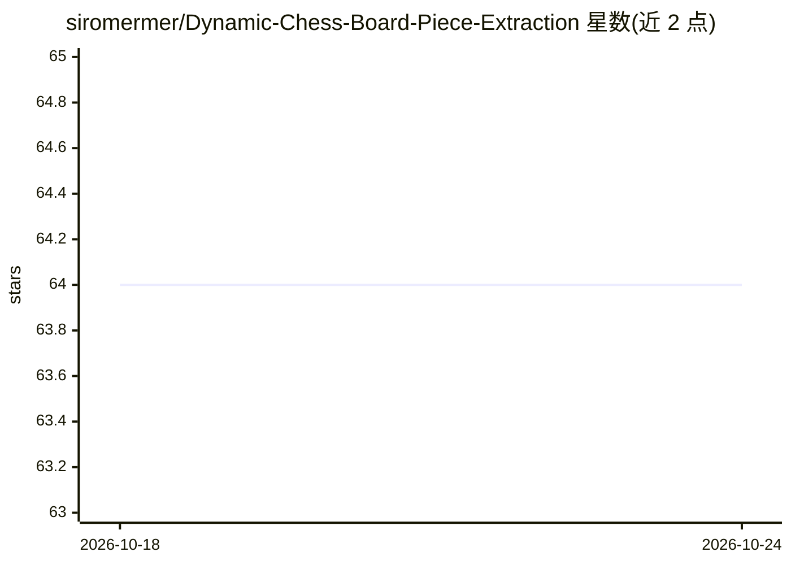

# siromermer/Dynamic-Chess-Board-Piece-Extraction

⭐ 64 · Jupyter Notebook · 推送 2026-05-05 · [GitHub](https://github.com/siromermer/Dynamic-Chess-Board-Piece-Extraction) · [官网](https://visionbrick.com/how-to-extract-chess-positions-from-any-photo/) · 个人维护

**从照片/实时视频提取棋盘局面并转为 FEN 的视觉管线**

基于 YOLO 与 RF-DETR 目标检测加图像处理（透视变换/方格填充两种算法）的计算机视觉系统：从静态图片或 OAK-D Lite 摄像头实时流中识别棋盘与棋子位置，输出标准 FEN 记法。提供 Python 脚本与 Jupyter notebook，附 CPU/GPU/RF-DETR 三种安装环境与 Docker 方案（Docker 仅 CPU）；另有 C++ 版本。衍生移动应用 Chesspector 已上架 Google Play。作者声明模型训练不足，棋子识别存在误检，棋盘位置较准。

## 筛选速览

| 维度 | 判定 | 备注 |
|---|---|---|
| AI 角色 | `ai-native` | 本体是模型或模型工具 |
| 许可风险 | `none` | — |
| 部署形态 | `self-host` | docker 或自建部署 |
| 模型依赖 | — | README 未给出锁定关系 |
| 硬件要求 | — | 无带数字的原话,不猜 |
| 安装摩擦 | `low` | 无编译、无系统依赖或容器化 |
| 成熟度 | `idea` | |

## 能力要点

- 双算法路线：方格填充（正视图像）与透视变换（多角度图像）
- YOLO 与 RF-DETR 两种训练好的棋子检测模型
- OAK-D Lite + DepthAI 实时版本与 C++ 版本
- 配套逐步可视化 notebook 与测试图像集

## 适用场景

- 把实体棋盘照片数字化为 FEN 用于分析
- 实时摄像头流中跟踪棋局变化
- 基于该管线二次训练更好的棋子检测模型

## 场景标签

`目标检测` `图像视频处理` · 领域:感知与多模态

## 证据(README 行号)

> L3: **Computer vision system that automatically extracts chess board positions and piece placements from images or real-
> L93: * chess-model-yolov8m.pt --> Trained YOLOv8 model for chess piece detection.

## 星数曲线

2026-10-18 64 → 2026-10-24 64（+0）

---
*卡片 v1 · prompt 1.4 · 生成 2026-10-24 · 置信度 high · 依据 README sha `564aeee031e3` · [字段定义](../../DATASET.md)*
