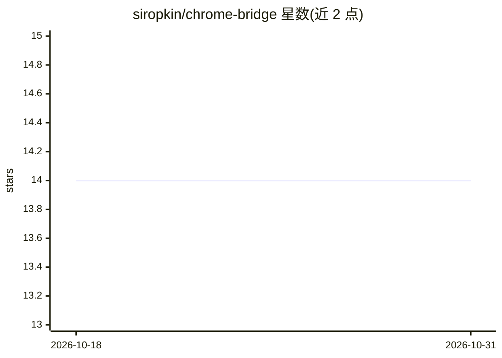

# siropkin/chrome-bridge

⭐ 14 · JavaScript · MIT · 推送 2026-10-21 · [GitHub](https://github.com/siropkin/chrome-bridge) · [官网](https://chromewebstore.google.com/detail/chrome-bridge/kmhjlnokjigmnimgjjmiahlinjbcebkg) · 个人维护 · 中文 README

**让 AI agent 驱动用户已登录真实 Chrome 的桥接工具**

由一个 Chrome 扩展和一个零依赖 Node CLI 组成的浏览器自动化桥：AI agent 通过 shell 命令操控用户正在使用的真实 Chrome——保留登录态、Cookie、SSO 与已打开标签页，无需独立浏览器或 MCP 服务器。本地服务器监听 127.0.0.1:9333，CLI 提供 snap/click/fill/shot 等约 30 个命令，页面以无障碍树文本形式返回元素引用。受控标签页显示紫色状态徽标并记录操作历史，用户可随时断开 agent 对标签页的控制。要求 macOS/Linux、Chrome ≥ 117、Node ≥ 18。

## 筛选速览

| 维度 | 判定 | 备注 |
|---|---|---|
| AI 角色 | `ai-ecosystem` | LLM/agent 周边工具 |
| 许可风险 | `permissive` | MIT |
| 部署形态 | `library` | 以包/库形式分发 |
| 模型依赖 | — | README 未给出锁定关系 |
| 硬件要求 | — | 无带数字的原话,不猜 |
| 安装摩擦 | `low` | 无编译、无系统依赖或容器化 |
| 成熟度 | — | 结构信号不足 |

## 能力要点

- 驱动用户真实已登录 Chrome，无需独立浏览器与 MCP 服务器
- 零依赖 Node CLI + 本地服务器（127.0.0.1:9333），约 30 个读写/标签页/设备模拟命令
- 🟣 徽标实时播报 agent 动作并留操作历史，用户可一键断开（强制生效）
- 支持任意能执行 shell 命令的 agent（Claude Code、Cursor、Qwen、GLM、Kimi 等）

## 适用场景

- 让 agent 用我已登录的标签页定时检查看板并发 Slack
- 不用重新登录就让 agent 从 CSV 填充 CMS 后台
- 让 agent 在带 SSO/VPN/防机器人检查的内网页面上代替操作

## 场景标签

`浏览器自动化` · 领域:效率与自动化

## 证据(README 行号)

> L9: Let **any AI agent** drive the Chrome you're already using: your real profile, already logged in, with your open tab
> L81: The extension connects to a small local server on `127.0.0.1:9333`. Your agent drives it through the CLI:
> L99: Writing your own agent loop? Skip the CLI and send JSON to `POST http://127.0.0.1:9333/cmd`, for example `{"type": 

## 星数曲线

2026-10-18 14 → 2026-10-31 14（+0）

---
*卡片 v1 · prompt 1.4 · 生成 2026-10-31 · 置信度 mid · 依据 README sha `c1a0953a62dd` · [字段定义](../../DATASET.md)*
