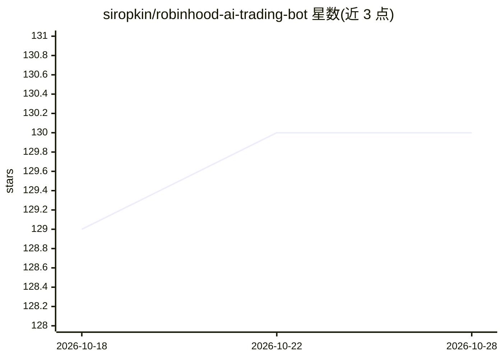

# siropkin/robinhood-ai-trading-bot

⭐ 131 · Python · MIT · 推送 2026-06-30 · [GitHub](https://github.com/siropkin/robinhood-ai-trading-bot) · [官网](https://goodbotty.bsky.social) · 个人维护

**用 OpenAI 分析 RSI/VWAP 等指标并自动执行 Robinhood 交易的脚本**

Python 脚本：从 Robinhood 账户读取自选股与持仓数据，计算 RSI、VWAP、50/200 日均线并汇总 Robinhood 分析师评级，将指标与用户约束（预算、排除清单、PDT 状态）组成提示词发给 OpenAI，按返回的 JSON 决策在 Demo/Manual/Auto 三种模式下执行买卖或持有。支持从 1Password 自动获取 MFA 密钥登录 Robinhood，带控制台日志。README 声明仅用于教育目的，并提示先在 Demo 或 Manual 模式测试。

## 筛选速览

| 维度 | 判定 | 备注 |
|---|---|---|
| AI 角色 | `ai-native` | 本体是模型或模型工具 |
| 许可风险 | `permissive` | MIT |
| 部署形态 | `library` | 以包/库形式分发 |
| 模型依赖 | — | README 未给出锁定关系 |
| 硬件要求 | — | 无带数字的原话,不猜 |
| 安装摩擦 | `low` | 无编译、无系统依赖或容器化 |
| 成熟度 | — | 结构信号不足 |

## 能力要点

- RSI/VWAP/移动平均/分析师评级输入 OpenAI 生成买卖持有决策
- Demo/Manual/Auto 三种执行模式
- PDT（日内交易者规则）保护机制
- 支持 1Password 服务账户自动获取 Robinhood MFA 密钥

## 适用场景

- 让 AI 基于技术指标自动管理我的 Robinhood 持仓
- 先在 Demo 模式模拟交易观察 AI 决策
- 跟踪分析自选股的买卖建议并手动确认执行

## 场景标签

`金融量化` · 领域:学习与行业

## 证据(README 行号)

> L47: 4. **AI-Driven Decisions**: Uses OpenAI to generate trading recommendations.
> L6: The **Robinhood AI Trading Bot** is a simple Python script

## 星数曲线

2026-10-18 129 → 2026-10-28 130（+1）

---
*卡片 v1 · prompt 1.4 · 生成 2026-10-22 · 置信度 mid · 依据 README sha `bd2e6e1dbc52` · [字段定义](../../DATASET.md)*
