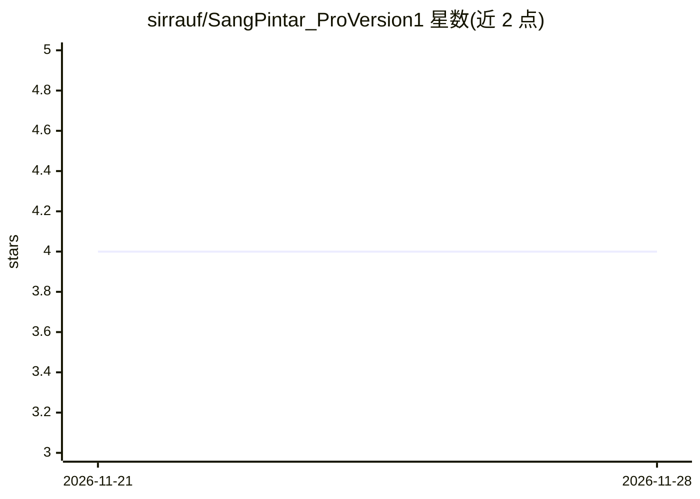

# sirrauf/SangPintar_ProVersion1

⭐ 4 · Python · GPL-3.0 · 推送 2026-11-20 · [GitHub](https://github.com/sirrauf/SangPintar_ProVersion1) · 组织维护

**面向印尼用户的自治 Telegram Bot：会计/建站/部署/WordPress 自动发文**

基于 Flask 框架的自治 AI Telegram Bot，声明集成 OpenClaw Gateway 与本地 Ollama LLM，用途覆盖会计、网站开发、网站部署与 WordPress 文章自动发布。README 提供运行流程：进入项目目录、创建并激活 Python venv、通过 pip 安装 requirements.txt 依赖后运行 app.py（或 flask run），Bot 在后台线程自动启动。README 未给出架构细节、许可证或配置说明。

## 筛选速览

| 维度 | 判定 | 备注 |
|---|---|---|
| AI 角色 | `ai-native` | 本体是模型或模型工具 |
| 许可风险 | `viral` | GPL-3.0 |
| 部署形态 | `library` | 以包/库形式分发 |
| 模型依赖 | local-ok | 支持本地模型 |
| 硬件要求 | — | 无带数字的原话,不猜 |
| 安装摩擦 | `low` | 无编译、无系统依赖或容器化 |
| 成熟度 | — | 结构信号不足 |

## 能力要点

- 自治 Telegram Bot，后台线程自动运行
- 声明集成 OpenClaw Gateway 与本地 Ollama LLM
- 基于 Flask Web 框架，提供 venv + pip 安装流程

## 适用场景

- 通过 Telegram 让 Bot 处理会计任务
- 自动开发与部署网站
- 自动发布 WordPress 文章

## 场景标签

`AI 助手` `聊天机器人` · 领域:对话与助手

## 证据(README 行号)

> L3: > **Autonomous AI Telegram Bot terintegrasi dengan OpenClaw Gateway & Ollama Local LLM menggunakan Web Framework Fla
> L27: pip install -r requirements.txt
> L42: Setelah perintah dijalankan, server Flask akan aktif dan Bot Telegram langsung berjalan otomatis di latar belakang 

## 星数曲线

2026-11-21 4 → 2026-11-28 4（+0）

---
*卡片 v1 · prompt 1.4 · 生成 2026-11-21 · 置信度 high · 依据 README sha `561626a204bb` · [字段定义](../../DATASET.md)*
