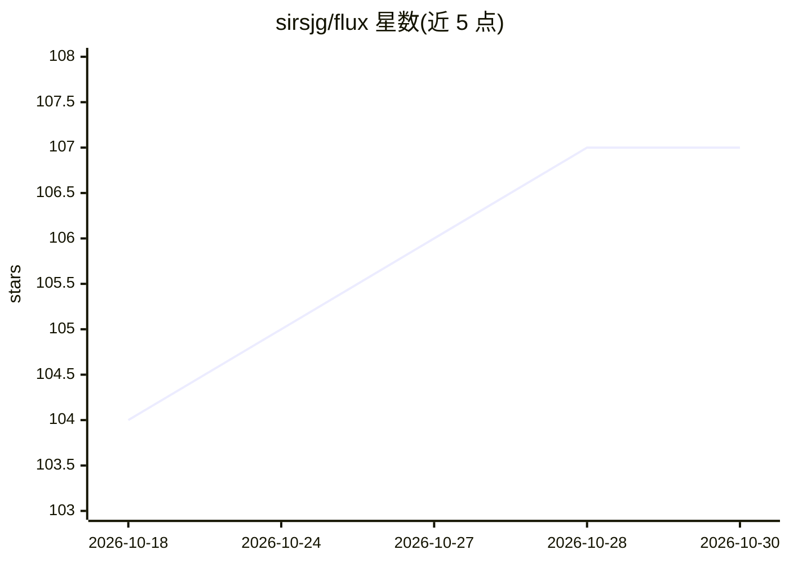

# sirsjg/flux

⭐ 107 · TypeScript · MIT · 推送 2026-10-21 · [GitHub](https://github.com/sirsjg/flux) · 个人维护

**人与 AI agent 共用的多项目看板任务管理引擎**

基于单一 JSON 文件存储的多项目 Kanban 看板，任务数据通过 git 分支（flux push/pull）同步，无需数据库。提供 CLI、Web 界面、REST API、签名 Webhook 与 MCP 服务器（25+ 工具），人类、脚本、CI 与 LLM 均可读写同一份数据。内置任务依赖、P0/P1/P2 优先级、验收标准与 guardrails、agent 记忆（任务评论）等面向自主工作的机制。可通过 npm 安装 CLI 或 Docker 快速启动全套栈，并给出 Claude Code/Desktop、ChatGPT、Codex 等助手的接入配置。

## 筛选速览

| 维度 | 判定 | 备注 |
|---|---|---|
| AI 角色 | `ai-enhanced` | 去掉 AI 部分产品仍成立 |
| 许可风险 | `permissive` | MIT |
| 部署形态 | `library` | 以包/库形式分发 |
| 模型依赖 | — | README 未给出锁定关系 |
| 硬件要求 | — | 无带数字的原话,不猜 |
| 安装摩擦 | `low` | 无编译、无系统依赖或容器化 |
| 成熟度 | — | 结构信号不足 |

## 能力要点

- 单一 JSON 文件存储 + git 分支同步，无数据库依赖
- MCP 服务器提供 25+ 工具，供 AI 助手增删改查任务
- 任务依赖、优先级、验收标准与 guardrails 面向 agent 工作
- CLI / Web / REST API / Webhook / MCP 多入口读写同一数据

## 适用场景

- 团队与 AI 助手共用一块看板跟踪项目任务
- 让 Claude/Codex 等编码 agent 通过 MCP 领取和关闭任务
- 通过 Webhook 与 n8n/Zapier/CI 自动化任务流转

## 场景标签

`工作流自动化` · 领域:效率与自动化

## 证据(README 行号)

> L7: Flux is a fast, multi-project Kanban board that humans, AI agents, and automations share. Tasks live in a single JSO
> L12: - **AI-native** — a full MCP server lets assistants list, create, update, and close tasks programmatically, with ag

## 星数曲线

2026-10-18 104 → 2026-10-30 107（+3）

---
*卡片 v1 · prompt 1.4 · 生成 2026-10-23 · 置信度 high · 依据 README sha `a7157eb03bb9` · [字段定义](../../DATASET.md)*
